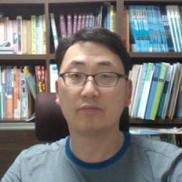

<!--
How to add an entry
- Each entry is one ::::: {.cv-item} block.
- Put [year]{.cv-year} first, then the content in a ::: {.cv-body} block.
- Mark talk types with [Talk]{.cv-tag}, [Poster]{.cv-tag .poster} or [Webinar]{.cv-tag .webinar}.
-->

```{=html}
<header class="cv-hero">
  
  <div class="cv-hero-text">
    <p class="cv-eyebrow">Curriculum Vitae</p>
    <h1 class="cv-name">Junho Lee</h1>
    <p class="cv-role">Team Head, Financial Supervisory Service (Korea) · PhD in Statistics, University of Edinburgh</p>
    <ul class="cv-interests" aria-label="Research interests">
      <li>Extreme value theory</li>
      <li>Bayesian methods</li>
      <li>Market fraud detection</li>
      <li>Climate stress testing</li>
    </ul>
    <nav class="cv-links" aria-label="CV sections">
      <a href="#education">Education</a>
      <a href="#publications">Publications</a>
      <a href="#talks">Talks</a>
      <a href="#work">Experience</a>
      <a href="https://www.github.com/morner75">GitHub</a>
      <a href="https://www.linkedin.com/in/junho-lee-050943267/">LinkedIn</a>
    </nav>
  </div>
</header>
```

## Education {#education}

::::: {.cv-item}
[2022]{.cv-year}

::: {.cv-body}
**Doctor of Philosophy in Statistics, University of Edinburgh, UK**\
[Thesis: *Bayesian analysis of non-stationary extremes*]{.cv-meta}
:::
:::::

::::: {.cv-item}
[2017]{.cv-year}

::: {.cv-body}
**Master of Science in Statistics & Operational Research, University of Edinburgh, UK**\
[Dissertation: *A primer on Benford's Law*]{.cv-meta}
:::
:::::

::::: {.cv-item}
[2010]{.cv-year}

::: {.cv-body}
**Bachelor of Laws, Korea National Open University, South Korea**
:::
:::::

::::: {.cv-item}
[2003]{.cv-year}

::: {.cv-body}
**Master of Arts in Economics, Yonsei University, South Korea**\
[Thesis: *A study on the won/dollar exchange rate in the short and long run: comparing the time and frequency domain approaches*]{.cv-meta}
:::
:::::

::::: {.cv-item}
[2001]{.cv-year}

::: {.cv-body}
**Bachelor of Arts in Economics, Yonsei University, South Korea**
:::
:::::

## Publications {#publications}

::::: {.cv-item}
[2026]{.cv-year}

::: {.cv-body}
**The impact of the Virtual Asset User Protection Act on wash trading in the domestic virtual asset market: An empirical study based on transaction data**\
[Lee, J. & Choi, B. · *Working paper*]{.cv-meta}
:::
:::::

::::: {.cv-item}
[2026]{.cv-year}

::: {.cv-body}
**[Early identification of behavioural changes using accelerometers in dairy calves with neonatal calf diarrhoea](https://doi.org/10.1016/j.anopes.2026.100158)**\
[Kang, H., Lee, J., Sandilands, V., Jarvis, S. & Haskell, M.J. · *Animal - Open Space*, 5, 100158]{.cv-meta}
:::
:::::

::::: {.cv-item}
[2024]{.cv-year}

::: {.cv-body}
**[Bayesian smoothing for time‑varying extremal dependence](https://doi.org/10.1093/jrsssc/qlae002)**\
[Lee, J., de Carvalho, M., Rua, A. & Avila, J. · *Journal of the Royal Statistical Society: Series C*, 73(3), 581–597]{.cv-meta}
:::
:::::

::::: {.cv-item}
[2024]{.cv-year}

::: {.cv-body}
**[A study on corporate greenhouse gas emission and loan provision](https://doi.org/10.23229/fss.2024.11.1.003)**\
[Yoon, Y., Lee, J. & Hwang, J. · *Journal of Financial Regulation and Supervision*, 11(1), 67–101]{.cv-meta}
:::
:::::

::::: {.cv-item}
[2023]{.cv-year}

::: {.cv-body}
**[Joint climate stress-test](https://www.fss.or.kr/fss/bbs/B0000083/view.do?nttId=132378&menuNo=200398&pageIndex=1)**\
[Lee, J., Kim, J. & Choi, K. · *FSS working paper* 2023-1]{.cv-meta}
:::
:::::

::::: {.cv-item}
[2023]{.cv-year}

::: {.cv-body}
**[A study on the relationship between corporate carbon emissions and stock market returns](http://doi.org/10.23229/fss.2023.10.2.001)**\
[Yoon, Y., Lee, J. & Hwang, J. · *Journal of Financial Regulation and Supervision*, 10(2), 1–44]{.cv-meta}
:::
:::::

::::: {.cv-item}
[2019]{.cv-year}

::: {.cv-body}
**[Technological improvements or climate change? Bayesian modeling of time‑varying conformance to Benford’s Law](https://doi.org/10.1371/journal.pone.0213300)**\
[Lee, J. & de Carvalho, M. · *PLOS ONE*, 14(4), e0213300]{.cv-meta}
:::
:::::

## Talks/Posters {#talks}

::::: {.cv-item}
[2025]{.cv-year}

::: {.cv-body}
**Global Insights on Advancing Financial Market Deepening** [Talk]{.cv-tag}\
[Lee, J. · OJK Risk and Governance Summit 2025, ‘Empowering the GRC Ecosystem to Drive Economic Growth and National Resilience’, Aug 2025, Jakarta, Indonesia]{.cv-meta}
:::
:::::

::::: {.cv-item}
[2023]{.cv-year}

::: {.cv-body}
**Stress-testing & other macroprudential supervision techniques in the Financial Supervisory Service** [Talk]{.cv-tag}\
[Lee, J. · NFSC-KOICA international conference, ‘Vietnam's financial market: Opportunities and challenges’, Dec 2023, Dalat, Vietnam]{.cv-meta}
:::
:::::

::::: {.cv-item}
[2023]{.cv-year}

::: {.cv-body}
**Climate stress‑testing for banking and insurance sectors in South Korea** [Webinar]{.cv-tag .webinar}\
[Lee, J. & Kim, J. · SPGMI-KPMG Webinar, Mar 2023, online]{.cv-meta}
:::
:::::

::::: {.cv-item}
[2021]{.cv-year}

::: {.cv-body}
**Bayesian Semiparametric Inferences for Covariate‑adjusted Extreme‑value Copula with application to Cryptocurrency Markets** [Talk]{.cv-tag}\
[Lee, J. & de Carvalho, M. · XXV Congress of the Portuguese Statistical Society, Nov 2021, Portugal]{.cv-meta}
:::
:::::

::::: {.cv-item}
[2021]{.cv-year}

::: {.cv-body}
**Bayesian smoothing of time‑varying extremal dependence in international stock markets** [Talk]{.cv-tag}\
[Lee, J., de Carvalho, M. & Rua, A. · Eco‑stats 2021, Jun 2021, Hong Kong]{.cv-meta}
:::
:::::

::::: {.cv-item}
[2019]{.cv-year}

::: {.cv-body}
**Bayesian semiparametric regression for heavy‑tailed responses** [Talk]{.cv-tag}\
[Lee, J., de Carvalho, M. & Rua, A. · CMstatistics 2019, 14–16 Dec 2019, London, UK]{.cv-meta}
:::
:::::

::::: {.cv-item}
[2019]{.cv-year}

::: {.cv-body}
**Bayesian semi‑parametric modelling of heteroscedastic extremes** [Talk]{.cv-tag}\
[Lee, J., de Carvalho, M. & Rua, A. · Extreme Value Analysis 2019, Jul 2019, Zagreb, Croatia]{.cv-meta}
:::
:::::

::::: {.cv-item}
[2019]{.cv-year}

::: {.cv-body}
**What hides behind an extreme currency demand? Bayesian semi‑parametric modelling of heteroscedastic extremes** [Poster]{.cv-tag .poster}\
[Lee, J., de Carvalho, M. & Rua, A. · Centre for Statistics conference, Jun 2019, Edinburgh, UK]{.cv-meta}
:::
:::::

::::: {.cv-item}
[2018]{.cv-year}

::: {.cv-body}
**Modelling Time‑Varying Conformance to Benford’s Law** [Poster]{.cv-tag .poster}\
[Lee, J. & de Carvalho, M. · ISBA 2018 World meeting, Jun 2018, Edinburgh, UK]{.cv-meta}
:::
:::::

## Work Experience {#work}

::: {.cv-org}
**Financial Supervisory Service** [2003 – present]{.cv-meta}
:::

::::: {.cv-item}
[2026 – present]{.cv-year}

::: {.cv-body}
**Virtual asset market analysis and market fraud investigation**\
[Virtual Asset Investigation Analysis Team · Team Head]{.cv-meta}
:::
:::::

::::: {.cv-item}
[2024 – 2025]{.cv-year}

::: {.cv-body}
**Leading a KOICA project developing an Early Warning System in Vietnam**\
[Project Manager]{.cv-meta}
:::
:::::

::::: {.cv-item}
[2024]{.cv-year}

::: {.cv-body}
**Developing fraud detection models in stock markets**\
[Lead Examiner]{.cv-meta}
:::
:::::

::::: {.cv-item}
[2021 – 2023]{.cv-year}

::: {.cv-body}
**Stress‑testing of financial companies and scenario analysis of climate change**\
[Lead Manager]{.cv-meta}
:::
:::::

::::: {.cv-item .cv-leave}
[2016 – 2020]{.cv-year}

::: {.cv-body}
**Leave for academic training**\
[University of Edinburgh]{.cv-meta}
:::
:::::

::::: {.cv-item}
[2013 – 2016]{.cv-year}

::: {.cv-body}
**Investigating market frauds in capital markets**\
[Senior Examiner]{.cv-meta}
:::
:::::

::::: {.cv-item}
[2010 – 2013]{.cv-year}

::: {.cv-body}
**Examining financial investment companies**\
[Senior Examiner]{.cv-meta}
:::
:::::

::::: {.cv-item}
[2007 – 2010]{.cv-year}

::: {.cv-body}
**Investigating market frauds in stock and derivative markets**\
[Senior Examiner]{.cv-meta}
:::
:::::

::::: {.cv-item}
[2005 – 2007]{.cv-year}

::: {.cv-body}
**Inspecting corporate disclosure reports**\
[Manager]{.cv-meta}
:::
:::::

::::: {.cv-item}
[2003 – 2005]{.cv-year}

::: {.cv-body}
**Developing on‑site examination techniques**\
[Examiner]{.cv-meta}
:::
:::::
