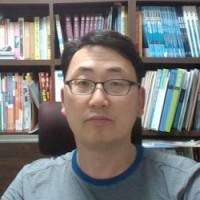

<!--
항목 작성법
- 각 항목은 ::::: {.cv-item} 블록 하나이다.
- [연도]{.cv-year} 다음에 ::: {.cv-body} 블록으로 내용을 쓴다.
- 발표 종류는 [Talk]{.cv-tag}, [Poster]{.cv-tag .poster}, [Webinar]{.cv-tag .webinar} 로 표시한다.
-->

```{=html}
<header class="cv-hero">
  
  <div class="cv-hero-text">
    <p class="cv-eyebrow">Curriculum Vitae</p>
    <h1 class="cv-name">이준호 <span>Junho Lee</span></h1>
    <p class="cv-role">금융감독원 가상자산조사국 팀장 · 통계학 박사 (영국 에든버러대학교)</p>
    <ul class="cv-interests" aria-label="연구 분야">
      <li>극단값 이론</li>
      <li>베이지안 방법론</li>
      <li>시장 불공정거래</li>
      <li>기후 스트레스테스트</li>
    </ul>
    <nav class="cv-links" aria-label="CV 목차">
      <a href="#education">학력</a>
      <a href="#publications">논문</a>
      <a href="#talks">발표</a>
      <a href="#work">경력</a>
      <a href="https://www.github.com/morner75">GitHub</a>
      <a href="https://www.linkedin.com/in/junho-lee-050943267/">LinkedIn</a>
    </nav>
  </div>
</header>
```

## Education {#education}

::::: {.cv-item}
[2022]{.cv-year}

::: {.cv-body}
**영국 에든버러대학교 통계학 박사**\
[학위논문: *Bayesian analysis of non-stationary extremes*]{.cv-meta}
:::
:::::

::::: {.cv-item}
[2017]{.cv-year}

::: {.cv-body}
**영국 에든버러대학교 통계학·OR 석사**\
[학위논문: *A primer on Benford's Law*]{.cv-meta}
:::
:::::

::::: {.cv-item}
[2010]{.cv-year}

::: {.cv-body}
**한국방송통신대학교 법학사**
:::
:::::

::::: {.cv-item}
[2003]{.cv-year}

::: {.cv-body}
**연세대학교 경제학 석사**\
[학위논문: *장단기 원/달러 환율에 대한 연구: Time-domain과 Frequency-domain 비교*]{.cv-meta}
:::
:::::

::::: {.cv-item}
[2001]{.cv-year}

::: {.cv-body}
**연세대학교 경제학사**
:::
:::::

## Publications {#publications}

::::: {.cv-item}
[2026]{.cv-year}

::: {.cv-body}
**가상자산이용자보호법 시행이 국내 가상자산시장의 워시 트레이딩에 미친 영향: 거래 데이터 기반 실증 분석**\
[이준호·최범전 · *Working paper*]{.cv-meta}
:::
:::::

::::: {.cv-item}
[2026]{.cv-year}

::: {.cv-body}
**[Early identification of behavioural changes using accelerometers in dairy calves with neonatal calf diarrhoea](https://doi.org/10.1016/j.anopes.2026.100158)**\
[Kang, H., Lee, J., Sandilands, V., Jarvis, S. & Haskell, M.J. · *Animal - Open Space*, 5, 100158]{.cv-meta}
:::
:::::

::::: {.cv-item}
[2024]{.cv-year}

::: {.cv-body}
**[Bayesian smoothing for time‑varying extremal dependence](https://doi.org/10.1093/jrsssc/qlae002)**\
[Lee, J., de Carvalho, M., Rua, A. & Avila, J. · *Journal of the Royal Statistical Society: Series C*, 73(3), 581–597]{.cv-meta}
:::
:::::

::::: {.cv-item}
[2024]{.cv-year}

::: {.cv-body}
**[기업의 온실가스 배출과 신용공급에 관한 연구](https://doi.org/10.23229/fss.2024.11.1.003)**\
[윤양인·이준호·황재학 · *금융감독연구*, 11(1), 67–101]{.cv-meta}
:::
:::::

::::: {.cv-item}
[2023]{.cv-year}

::: {.cv-body}
**[금융권 공동 기후 스트레스테스트](https://www.fss.or.kr/fss/bbs/B0000083/view.do?nttId=132378&menuNo=200398&pageIndex=1)**\
[이준호·김정일·최광신 · *FSS working paper* 2023-1]{.cv-meta}
:::
:::::

::::: {.cv-item}
[2023]{.cv-year}

::: {.cv-body}
**[기업의 탄소배출과 주가수익률간 관계에 관한 연구](http://doi.org/10.23229/fss.2023.10.2.001)**\
[윤양인·이준호·황재학 · *금융감독연구*, 10(2), 1–44]{.cv-meta}
:::
:::::

::::: {.cv-item}
[2019]{.cv-year}

::: {.cv-body}
**[Technological improvements or climate change? Bayesian modeling of time‑varying conformance to Benford’s Law](https://doi.org/10.1371/journal.pone.0213300)**\
[Lee, J. & de Carvalho, M. · *PLOS ONE*, 14(4), e0213300]{.cv-meta}
:::
:::::

## Talks/Posters {#talks}

::::: {.cv-item}
[2025]{.cv-year}

::: {.cv-body}
**Global Insights on Advancing Financial Market Deepening** [Talk]{.cv-tag}\
[Lee, J. · OJK Risk and Governance Summit 2025, ‘Empowering the GRC Ecosystem to Drive Economic Growth and National Resilience’, Aug 2025, Jakarta, Indonesia]{.cv-meta}
:::
:::::

::::: {.cv-item}
[2023]{.cv-year}

::: {.cv-body}
**Stress-testing & other macroprudential supervision techniques in the Financial Supervisory Service** [Talk]{.cv-tag}\
[Lee, J. · NFSC-KOICA international conference, ‘Vietnam's financial market: Opportunities and challenges’, Dec 2023, Dalat, Vietnam]{.cv-meta}
:::
:::::

::::: {.cv-item}
[2023]{.cv-year}

::: {.cv-body}
**금융감독기관의 기후스트레스테스트 진행현황 및 향후계획** [Webinar]{.cv-tag .webinar}\
[이준호·김정일 · SPGMI-KPMG 웹비나, 2023.3]{.cv-meta}
:::
:::::

::::: {.cv-item}
[2021]{.cv-year}

::: {.cv-body}
**Bayesian Semiparametric Inferences for Covariate‑adjusted Extreme‑value Copula with application to Cryptocurrency Markets** [Talk]{.cv-tag}\
[Lee, J. & de Carvalho, M. · XXV Congress of the Portuguese Statistical Society, Nov 2021, Portugal]{.cv-meta}
:::
:::::

::::: {.cv-item}
[2021]{.cv-year}

::: {.cv-body}
**Bayesian smoothing of time‑varying extremal dependence in international stock markets** [Talk]{.cv-tag}\
[Lee, J., de Carvalho, M. & Rua, A. · Eco‑stats 2021, Jun 2021, Hong Kong]{.cv-meta}
:::
:::::

::::: {.cv-item}
[2019]{.cv-year}

::: {.cv-body}
**Bayesian semiparametric regression for heavy‑tailed responses** [Talk]{.cv-tag}\
[Lee, J., de Carvalho, M. & Rua, A. · CMstatistics 2019, 14–16 Dec 2019, London, UK]{.cv-meta}
:::
:::::

::::: {.cv-item}
[2019]{.cv-year}

::: {.cv-body}
**Bayesian semi‑parametric modelling of heteroscedastic extremes** [Talk]{.cv-tag}\
[Lee, J., de Carvalho, M. & Rua, A. · Extreme Value Analysis 2019, Jul 2019, Zagreb, Croatia]{.cv-meta}
:::
:::::

::::: {.cv-item}
[2019]{.cv-year}

::: {.cv-body}
**What hides behind an extreme currency demand? Bayesian semi‑parametric modelling of heteroscedastic extremes** [Poster]{.cv-tag .poster}\
[Lee, J., de Carvalho, M. & Rua, A. · Centre for Statistics conference, Jun 2019, Edinburgh, UK]{.cv-meta}
:::
:::::

::::: {.cv-item}
[2018]{.cv-year}

::: {.cv-body}
**Modelling Time‑Varying Conformance to Benford’s Law** [Poster]{.cv-tag .poster}\
[Lee, J. & de Carvalho, M. · ISBA 2018 World meeting, Jun 2018, Edinburgh, UK]{.cv-meta}
:::
:::::

## Work Experience {#work}

::: {.cv-org}
**금융감독원** [2003 – 현재]{.cv-meta}
:::

::::: {.cv-item}
[2026 – 현재]{.cv-year}

::: {.cv-body}
**가상자산시장 분석 및 불공정거래조사**\
[가상자산조사국 · 팀장]{.cv-meta}
:::
:::::

::::: {.cv-item}
[2024 – 2025]{.cv-year}

::: {.cv-body}
**베트남 금융분야 조기경보체계 구축사업**\
[금융시장안정국 · 담당관(PM)]{.cv-meta}
:::
:::::

::::: {.cv-item}
[2024]{.cv-year}

::: {.cv-body}
**불공정거래 조사 및 시세조종탐지/자금추적 모형 개발**\
[조사2국 · 수석검사역]{.cv-meta}
:::
:::::

::::: {.cv-item}
[2021 – 2023]{.cv-year}

::: {.cv-body}
**스트레스테스트 및 기후시나리오 분석**\
[금융시장안정국 · 수석조사역]{.cv-meta}
:::
:::::

::::: {.cv-item .cv-leave}
[2016 – 2020]{.cv-year}

::: {.cv-body}
**학술연수 및 통계학 박사학위 과정**\
[에든버러 대학교]{.cv-meta}
:::
:::::

::::: {.cv-item}
[2013 – 2016]{.cv-year}

::: {.cv-body}
**불공정거래 조사·기획**\
[조사1국 · 선임검사역]{.cv-meta}
:::
:::::

::::: {.cv-item}
[2010 – 2013]{.cv-year}

::: {.cv-body}
**금융투자회사 검사**\
[금융투자서비스국·금융투자검사국 · 선임검사역]{.cv-meta}
:::
:::::

::::: {.cv-item}
[2007 – 2010]{.cv-year}

::: {.cv-body}
**파생상품·증권 불공정거래조사**\
[조사1·2국 · 선임검사역]{.cv-meta}
:::
:::::

::::: {.cv-item}
[2005 – 2007]{.cv-year}

::: {.cv-body}
**지분공시 심사**\
[공시감독국 · 조사역]{.cv-meta}
:::
:::::

::::: {.cv-item}
[2003 – 2005]{.cv-year}

::: {.cv-body}
**검사제도·기획**\
[검사총괄국 · 검사역]{.cv-meta}
:::
:::::
