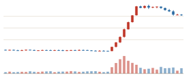
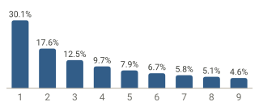
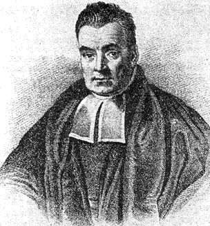
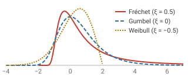
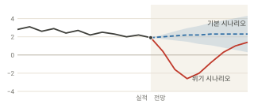
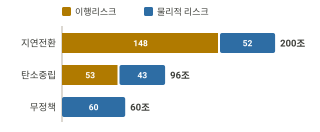

```{=html}
<section class="home-hero">
  <div class="home-hero-text">
    <p class="home-eyebrow">Practical Bayesian Extremist</p>
    <h1 class="home-name">이준호</h1>
    <p class="home-tagline">자본시장과 가상자산시장을 분석하고, <br>베이즈 통계학과 인공지능을 연구합니다.</p>
    <nav class="home-actions" aria-label="주요 페이지">
      <a href="research.html">Research</a>
      <a href="CV_KOR.html">CV</a>
      <a href="blog.html">Blog</a>
    </nav>
  </div>
  
</section>

<section class="home-intro">
  <p class="home-lead">제 블로그에 오신 걸 환영합니다.</p>
  <p>대학에서 경제학과 법학을 공부했고, 2003년 금융감독원에 입사했습니다. 2010년대 중반 데이터 혁명과 기계학습에 감명받아, 뒤늦은 40대에 영국 에든버러대학교(University of Edinburgh)로 유학을 떠나 통계학 박사학위를 받았습니다. 극단값 이론과 베이즈 비모수 통계학을 전공했고, R과 Python을 이용한 실용적인 데이터 분석과 통계·머신러닝 모형의 수학적 배경에 관심이 있습니다. 또한 공개 데이터와 AI를 활용한 다양한 Dashboard를 만드는 것을 취미로 삼고 있습니다. 현재 금융감독원에서 금융시장 분석 및 조사업무를 수행하고 있습니다.</p>
</section>

<section class="home-cards" aria-label="하는 일">
  <article class="home-card">
    <h2>시장 불공정거래 분석</h2>
    <figure class="home-chart">
      
      <figcaption>가상자산 급등 예시 그림. 실제 시세가 아닙니다.</figcaption>
    </figure>
    <p>금융감독원에서 불공정거래 조사/분석 업무를 담당하면서 시세조종 탐지 모형과 알고리즘을 연구합니다.</p>
    <a href="research/wash-trading/index.html">워시 트레이딩 연구 →</a>
  </article>
  <article class="home-card">
    <h2>벤포드 법칙(Benford's Law)</h2>
    <figure class="home-chart">
      
      <figcaption>벤포드 법칙의 첫 자리 분포: P(d) = log<sub>10</sub>(1 + 1/d)</figcaption>
    </figure>
    <p>벤포드 법칙을 이상현상 탐지 등 다양한 영역에서 활용하는 법을 연구합니다.</p>
    <a href="research/benford-cyclones/index.html">벤포드 법칙 연구 →</a>
  </article>
  <article class="home-card">
    <h2>베이지안 방법론</h2>
    <div class="home-bayes">
      
      <p class="home-formula">P(θ | y) ∝ P(y | θ) P(θ)</p>
    </div>
    <p>Bayesian Smoothing, Bayesian Vector Autoregression, Bayesian Networks 등 다양한 베이지안 모형을 연구합니다.</p>
    <a href="posts/smoothing/smoothing2.html">베이지안 평활기법 글 →</a>
  </article>
  <article class="home-card">
    <h2>극단값 이론</h2>
    <figure class="home-chart">
      
      <figcaption>극값분포의 세 유형(μ = 0, σ = 1). 오른쪽 꼬리의 모양이 서로 다릅니다.</figcaption>
    </figure>
    <p>극단값 이론(Extreme Value Theory)을 활용한 응용사례를 연구합니다.</p>
    <a href="research/tail-dependence/index.html">극단적 동조화 연구 →</a>
  </article>
  <article class="home-card">
    <h2>금융시장 및 금융산업 분석</h2>
    <figure class="home-chart">
      
      <figcaption>스트레스테스트 시나리오 예시: GDP 성장률(%). 실제 전망이 아닙니다.</figcaption>
    </figure>
    <p>Macrofinancial Stress Test, GDP Nowcasting 모형 등 금융시장과 금융산업에 대한 다양한 모형을 개발합니다.</p>
  </article>
  <article class="home-card">
    <h2>기후변화와 금융시장 분석</h2>
    <figure class="home-chart">
      
      <figcaption>2050년까지 시나리오별 누적 추가 신용손실(조 원). 금융권 공동 기후 스트레스테스트 결과입니다.</figcaption>
    </figure>
    <p>기후변화가 금융시장에 미치는 영향 등 다양한 기후변화 응용사례를 연구합니다.</p>
    <a href="research/climate-stress-test/index.html">기후 스트레스테스트 연구 →</a>
  </article>
</section>

<section class="home-latest-head">
  <h2>최신 연구</h2>
  <a href="research.html">전체 보기 →</a>
</section>
```

:::{#home-latest}
:::

```{=html}
<p class="home-disclaimer">이 블로그의 내용은 개인 견해이며, 소속 기관의 공식 입장과 무관합니다.</p>
```
