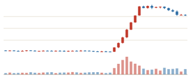
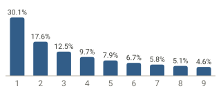
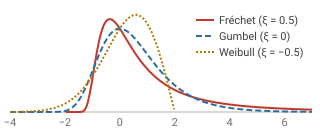
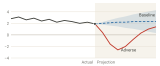
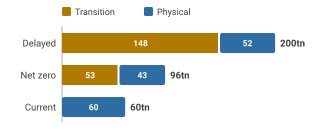

```{=html}
<section class="home-hero">
  <div class="home-hero-text">
    <p class="home-eyebrow">Practical Bayesian Extremist</p>
    <h1 class="home-name">Junho Lee</h1>
    <p class="home-tagline">I analyse capital and virtual asset markets, <br>and study Bayesian statistics and AI.</p>
    <nav class="home-actions" aria-label="Main pages">
      <a href="research.html">Research</a>
      <a href="CV_ENG.html">CV</a>
      <a href="blog.html">Blog</a>
    </nav>
  </div>
  
</section>

<section class="home-intro">
  <p class="home-lead">Welcome to my blog.</p>
  <p>I have a PhD in Statistics from the University of Edinburgh and joined the Financial Supervisory Service in South Korea in 2003. I specialised in extreme value theory and Bayesian nonparametrics and am interested in practical data analysis in R and Python, and the mathematical foundations of statistical and machine learning models. In my spare time, I build dashboards using public data and AI. I currently work on financial market analysis and investigation at the Financial Supervisory Service.</p>
</section>

<section class="home-cards" aria-label="What I do">
  <article class="home-card">
    <h2>Unfair trading analysis</h2>
    <figure class="home-chart">
      
      <figcaption>Illustrative virtual asset surge; not real market data.</figcaption>
    </figure>
    <p>At the Financial Supervisory Service, I investigate and analyse unfair trading, and study detection models and algorithms for market manipulation.</p>
    <a href="research/wash-trading/index.html">Wash trading study (in Korean) →</a>
  </article>
  <article class="home-card">
    <h2>Benford's Law</h2>
    <figure class="home-chart">
      
      <figcaption>Benford first-digit distribution: P(d) = log<sub>10</sub>(1 + 1/d)</figcaption>
    </figure>
    <p>I study how to apply Benford's Law in areas such as anomaly detection.</p>
    <a href="research/benford-cyclones/index.html">Benford's Law study (in Korean) →</a>
  </article>
  <article class="home-card">
    <h2>Bayesian methods</h2>
    <div class="home-bayes">
      
      <p class="home-formula">P(θ | y) ∝ P(y | θ) P(θ)</p>
    </div>
    <p>I study a range of Bayesian models, including Bayesian smoothing, Bayesian vector autoregression and Bayesian networks.</p>
    <a href="posts/smoothing/smoothing2.html">Bayesian smoothing post (in Korean) →</a>
  </article>
  <article class="home-card">
    <h2>Extreme value theory</h2>
    <figure class="home-chart">
      
      <figcaption>The three extreme value types (μ = 0, σ = 1). Their right tails differ in shape.</figcaption>
    </figure>
    <p>I study applications of extreme value theory (EVT).</p>
    <a href="research/tail-dependence/index.html">Extremal dependence study (in Korean) →</a>
  </article>
  <article class="home-card">
    <h2>Financial markets and industry analysis</h2>
    <figure class="home-chart">
      
      <figcaption>Illustrative stress-test scenarios: GDP growth (%). Not an actual projection.</figcaption>
    </figure>
    <p>I develop a range of models for financial markets and the financial industry, including macrofinancial stress tests and GDP nowcasting.</p>
  </article>
  <article class="home-card">
    <h2>Climate change and financial markets</h2>
    <figure class="home-chart">
      
      <figcaption>Cumulative additional credit losses to 2050 by scenario (KRW tn), from the joint climate stress test of Korean banks and insurers.</figcaption>
    </figure>
    <p>I study a range of climate change applications, such as the effects of climate change on financial markets.</p>
    <a href="research/climate-stress-test/index.html">Climate stress test (in Korean) →</a>
  </article>
</section>

<section class="home-latest-head">
  <h2>Latest research <span>(explainers in Korean)</span></h2>
  <a href="research.html">View all →</a>
</section>
```

:::{#home-latest}
:::

```{=html}
<p class="home-disclaimer">The views expressed on this blog are my own and do not represent those of my employer.</p>
```
