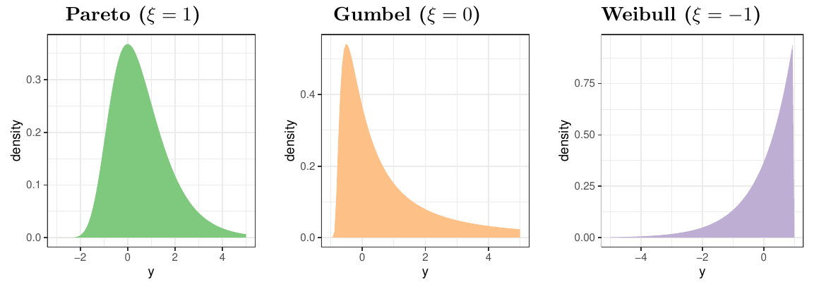



극단값 이론(extreme-value theory)은 드물게 일어나지만 일단 일어나면 파국적인 결과를 낳는 사건, 즉 분포의 꼬리(tail)와 관련된 사건을 모형화하는 확률론적·통계적 접근법이다 (Coles, 2001; Beirlant et al., 2004; de Haan and Ferreira, 2007; Davison and Huser, 2015; Dey and Yan, 2016). 극단값 이론은 고전적 통계 방법을 보완하거나 때로는 대체하는 수단으로서 수문학(Katz et al., 2002), 기후학(Buishand, 1989), 보건학(Thomas et al., 2016), 공학(Castillo, 2012), 금융(Longin, 2016) 등 여러 분야에서 수요가 커지고 있다. 예를 들어 금융자산 수익률을 분석할 때 극단값 이론은 드물지만 파국적인 주식시장 폭락의 가능성을 평가하는 데 도움을 줄 수 있으며, 이는 위험관리 관점에서 매우 중요한 현상이다.

이 글에서는 독립이고 동일한 분포를 따르는(i.i.d.) 확률변수열에 대한 일변량 극단값 이론의 기초를 정리하고, 시간에 따라 변하는 비정상(nonstationary) 극단값으로 넘어간다. i.i.d. 극단값을 모형화하는 확률적 접근은 크게 두 가지이다. **일반화 극단값(generalised extreme-value, GEV) 분포**는 표본 최댓값의 극한과 관련되고, **일반화 파레토(generalised Pareto, GP) 분포**는 어떤 높은 임계값(threshold)을 넘는 관측값과 관련된다. 아래 서술은 Coles (2001)와 Beirlant et al. (2004)를 따른다.

## 일반화 극단값 분포

확률변수 $X$ 가 오른쪽 끝점 $x^* = \sup\{x : F(x) < 1\}$ 을 갖는 분포함수 $F$ 를 따른다고 하자. $X_1,\ldots,X_n$ 을 크기 $n$ 인 확률표본, $X_{k,n}$ 을 표본의 $k$ 번째 순서통계량이라 하자. 표본 최댓값 $X_{n,n}=\max\{X_1,\ldots,X_n\}$ 의 극한분포는 점 $x^*$ 에서 퇴화(degenerate)한다. 모든 $x<x^*$ 에 대해

$$
P(X_{n,n}\le x)=P(X_1\le x,\ldots,X_n\le x)=F^n(x)\to 0 \quad (n\to\infty)
$$

이기 때문이다. 퇴화하지 않는 극한분포를 얻으려면, 중심극한정리를 적용할 때 표본평균을 표준화하듯이 두 정규화 수열 $\{a_n>0\}$ 과 $\{b_n\}$ 을 도입하여 모든 $x\in\mathbb R$ 에 대해

$$
P\left(\frac{X_{n,n}-b_n}{a_n}\le x\right)=F^n(a_nx+b_n)\to G(x)\quad (n\to\infty)
$$ {#eq-ev-condition}

가 되도록 한다. 이 정규화를 **극단값 조건(extreme-value condition)** 이라 하며, 극한이 존재하면 그 극한분포는 일반화 극단값 분포족이 된다 (Fisher and Tippett, 1928; Gnedenko, 1943; de Haan, 1970).

::: {#thm-fisher-tippett}
## Fisher–Tippett–Gnedenko

@eq-ev-condition 을 만족하는 수열 $\{a_n>0\}$ 과 $\{b_n\}$ 이 존재하면, 분포 $G$ 는 다음 일반화 극단값 분포족과 같은 유형(type)이다.

$$
G(x)=\exp\{-(1+\xi x)^{-1/\xi}\},\quad 1+\xi x>0,\quad \xi\in\mathbb R.
$$

$\xi=0$ 인 경우는 $G(x)=\exp\{-\exp(-x)\}$ 로 해석한다. 모수 $\xi$ 를 **극단값 지수(extreme-value index)** 라 한다.
:::

증명은 de Haan and Ferreira (2007, pp. 7–8)를 참고하라.

GEV 분포족의 극단값 지수 $\xi$ 는 분포함수 $F$ 의 꼬리 행태를 결정한다. $\xi>0$, $\xi=0$, $\xi<0$ 은 각각 두꺼운 꼬리(heavy tail), 가벼운 꼬리(light tail), 짧은 꼬리(short tail)를 나타내며, 각각 파레토형(Pareto-type), 검벨형(Gumbel-type), 와이블형(Weibull-type) 분포라 부른다. @fig-gev 은 극단값 지수가 서로 다른 세 GEV 분포를 보여준다.

{#fig-gev fig-alt="극단값 지수가 1, 0, -1인 세 일반화 극단값 분포의 밀도함수. 파레토형은 오른쪽 꼬리가 길고, 검벨형은 오른쪽으로 지수적으로 감소하며, 와이블형은 오른쪽 끝점에서 끝난다."}

@eq-ev-condition 의 극단값 조건은 $X$ 의 분포가 극한분포 $G$ 를 갖기 위한 필요충분조건이며, 어떤 특정 GEV 분포로의 극한이 성립하도록 하는 수열 $\{a_n\}$, $\{b_n\}$ 이 존재하는 분포함수 $F$ 를 특징짓는다. 극단값 조건이 성립하면 $F$ 는 극단값 분포 $G$ 의 **끌림 영역(domain of attraction)** 에 속한다고 하고, $F\in D_\xi(G)$ 로 표기한다.

극단값 조건은 꼬리 분위함수나 생존함수로도 동등하게 표현할 수 있다. $X$ 의 꼬리 분위함수(tail quantile function) $U$ 는 다음과 같이 정의되는 우연속 역함수이다.

$$
U(y)=\inf\left\{x : F(x)\ge 1-\frac{1}{y}\right\},\quad y\ge 1.
$$

$U$ 는 $[1,\infty)$ 에서 감소하지 않으며 $U(\infty)=x^*$ 이다. $F$ 가 연속이면 단순히 $U(y)=F^{-1}(1-1/y)$ 이다. 다음 정리는 극단값 조건의 세 가지 동치 표현을 제시한다.

::: {#thm-equivalent}
## 극단값 조건의 동치 표현

$\xi\in\mathbb R$ 에 대해 다음 명제들은 서로 동치이다.

1. 실수열 $\{a_n>0\}$, $\{b_n\}$ 이 존재하여 $1+\xi x>0$ 인 모든 $x$ 에 대해
   $$
   \lim_{n\to\infty}F^n(a_nx+b_n)=G(x)=\exp\{-(1+\xi x)^{-1/\xi}\}.
   $$
2. 보조함수 $a(\cdot)>0$ 이 존재하여 $u>0$ 에 대해
   $$
   \lim_{x\to\infty}\frac{U(ux)-U(x)}{a(x)}=h(u)=\frac{u^\xi-1}{\xi}.
   $$
   여기서 $\xi=0$ 이면 우변은 $\log u$ 로 해석한다.
3. 보조함수 $b(\cdot)$ 가 존재하여 $1+\xi y>0$ 인 모든 $y$ 에 대해
   $$
   \lim_{x\uparrow x^*}\frac{1-F\{x+b(x)y\}}{1-F(x)}=(1+\xi y)^{-1/\xi}.
   $$ {#eq-ev-survival}
:::

증명은 Beirlant et al. (2004, pp. 80–81)과 de Haan and Ferreira (2007, p. 11)를 참고하라.

### 블록 최댓값 방법

GEV 분포족은 월별·연별 최댓값처럼 **블록 최댓값(block maxima)** 의 분포를 모형화하는 데 유용하다. @thm-fisher-tippett 은 확률표본의 크기 $n$ 이 충분히 크면, 적절한 위치·척도 변환을 거친 표본 최댓값의 분포를 극단값 분포족 $G$ 로 근사할 수 있음을 뜻한다. 블록 최댓값 방법은 관측값을 같은 크기의 블록으로 나누고, 각 블록에서 얻은 최댓값들에 GEV 분포를 적합한다.

블록 크기의 선택에는 두 가지 근사 오차에서 오는 편향–분산 상충(bias–variance trade-off)이 따른다. 블록 수가 적고 블록마다 표본이 많으면 표본 최댓값이 GEV 분포를 잘 따르지만, 모형화에 쓸 최댓값의 개수가 줄어 모수 추정이 부정확해질 수 있다. 반대로 블록 수가 많고 블록마다 표본이 적으면 추정량의 분산은 줄지만 GEV 근사의 편향이 커진다.

## 임계값 초과 모형

블록 최댓값 모형은 각 블록에서 최댓값 하나만 쓴다. 그러나 최댓값에 가까운 다른 관측값들도 @eq-ev-condition 의 극단값 조건에서 분포 $G$ 를 따를 것으로 기대할 수 있다. 이 생각을 활용하는 것이 **임계값 초과(peaks-over-threshold, POT)** 모형이다.

$X$ 가 오른쪽 끝점 $x^*$ 를 갖는 분포함수 $F$ 를 따르고, $Y=X-u$ 를 어떤 임계값 $u$ 에 대한 초과량(exceedance)이라 하자. 임계값을 넘는 초과량 $Y$ 의 분포는

$$
F_u(y)=P(Y\le y\mid X>u)=\frac{F(u+y)-F(u)}{1-F(u)},\quad 0\le y\le x^*-u
$$

이다. 임계값 $u$ 가 충분히 크면 임계값 초과량의 분포는 일반화 파레토 분포로 근사할 수 있다.

::: {#thm-pbdh}
## Pickands–Balkema–de Haan

분포함수 $F$ 가 극단값 분포의 끌림 영역에 속한다고 하자. 즉, $F\in D_\xi(G)$, $\xi\in\mathbb R$ 이다. 그러면 조건부 초과 분포함수 $F_u(y)$ 는

$$
\lim_{u\to x^*}\ \sup_{0\le y\le x^*-u}\left|F_u(y)-H(y;\sigma,\xi)\right|=0
$$

을 만족한다. 여기서 $H$ 는 다음 형태의 일반화 파레토 분포이다.

$$
H(y;\sigma,\xi)=1-\left(1+\frac{\xi y}{\sigma}\right)^{-1/\xi},\quad y>0,\quad \xi\in\mathbb R.
$$ {#eq-gpd}

$H$ 는 $\{y:1+\xi y/\sigma>0\}$ 에서 정의되며, $\xi=0$ 이면 $H(y)=1-\exp(-y/\sigma)$ 로 해석한다.
:::

증명은 Pickands (1975)와 Balkema and de Haan (1974)를 참고하라.

@eq-gpd 의 극한분포는 @thm-equivalent 의 동치 조건 @eq-ev-survival 로부터 유도할 수 있다. $Y$ 의 조건부 생존함수를 $y^*b(u)$ 에서 계산하면

$$
\begin{aligned}
P(Y>y^*b(u)\mid Y>0)&=P(X-u>y^*b(u)\mid X-u>0)\\
&=P(X>u+y^*b(u)\mid X>u)\\
&=\frac{1-F\{u+y^*b(u)\}}{1-F(u)}\to(1+\xi y^*)^{-1/\xi}\quad (u\uparrow x^*)
\end{aligned}
$$

이다. $y=y^*b(u)$ 로 두면, 조건부 초과 분포함수는 어떤 모수 $\sigma_u>0$ 에 대해 다음과 같이 일반화 파레토 분포로 근사된다.

$$
P(Y\le y\mid X>u)\approx 1-\left\{1+\frac{\xi y}{b(u)}\right\}^{-1/\xi}=1-\left(1+\frac{\xi y}{\sigma_u}\right)^{-1/\xi}.
$$

극단값 분포에서와 마찬가지로 극단값 지수 $\xi$ 가 분포 $F$ 의 꼬리 행태를 지배한다. GP 분포의 지지집합(support)도 극단값 지수에 따라 달라진다. $\xi\ge0$ 이면 상한이 없지만, $\xi<0$ 이면 초과량은 상한 $-\sigma/\xi$ 를 갖는다.

임계값 선택에도 비슷한 편향–분산 상충이 있다. 임계값이 충분히 높지 않으면 GP 근사가 나빠지고, 너무 높으면 모수 추정의 분산이 커진다.

## 비정상 극단값

고전적 극단값 분석은 분포 꼬리에 대한 통계적 추론을 위해 관측값이 i.i.d.라고 가정한다. i.i.d. 가정에서 벗어나는 경우는 두 가지이다. 관측값이 계열 의존성(serial dependence)을 보이거나, 서로 다른 분포에서 나올 수 있다. **비정상 극단값(nonstationary extremes)** 은 시간에 따라 변하는 극단값의 성질을 반영하며, 지금도 활발히 연구되는 분야이다. 시간에 따른 극단값의 동학을 포착하기 위한 여러 통계모형이 제안되었다 (Davison and Smith, 1990; Coles, 2001; Chavez-Demoulin and Davison, 2005; Eastoe and Tawn, 2009; Wang and Tsai, 2009; Jonathan et al., 2014; Randell et al., 2016; Einmahl et al., 2016; Opitz et al., 2018; Einmahl et al., 2020; de Haan and Zhou, 2020; Johannesson et al., 2022).

자연스러운 접근은 GEV 분포나 GP 분포의 모수에 시간 첨자를 붙여 i.i.d. 극단값 이론을 확장하는 것이다 (Davison and Smith, 1990; Coles, 2001). 예를 들어 정규화된 최댓값 $X_t$ 의 극한분포를 비정상 GEV 모형으로 기술할 수 있다.

$$
X_t\sim \mathrm{GEV}\{\mu(t),\sigma(t),\xi(t)\},\quad t=1,\ldots,n.
$$

여기서 $\mu(t)$, $\sigma(t)$, $\xi(t)$ 는 시점 $t$ 에서 GEV 분포의 시변(time-varying) 위치·척도·형상 모수이다. 마찬가지로 두 모수를 갖는 비정상 GP 모형도 쓸 수 있다.

$$
Y_t\sim\mathrm{GP}\{\sigma(t),\xi(t)\},\quad t=1,\ldots,n.
$$

비정상 모형의 추론에는 여러 방법이 쓰였다. 전처리(Eastoe and Tawn, 2009), 분위회귀 기법(Jonathan et al., 2014), 베이지안 준모수 방법(Randell et al., 2016), 근사 베이지안 방법(Opitz et al., 2018), 비모수 방법(de Haan and Zhou, 2020) 등이다. 점과정(point process)이나 자료 변환으로 얻은 관측값의 표본분포가 포아송 분포나 지수분포 같은 지수족(exponential family)에 속하면, 일반화 선형모형(GLM)이나 일반화 가법모형(GAM)의 틀에서 추론할 수 있다 (Chavez-Demoulin and Davison, 2005; Wang and Tsai, 2009; Randell et al., 2016).

### 비례 꼬리 모형과 스케다시스 밀도

**비례 꼬리 모형(proportional tails model)** (Einmahl et al., 2016)은 비정상 극단값을 모형화하는 새로운 접근이다. 이 모형은 관측값이 독립이지만 동일하지 않은 분포에서 나온다고 가정하며, 분포가 완만하게 변하는 상황에서 극단값 통계를 극단값 지수뿐 아니라 극단 사건의 **빈도**로도 포착할 수 있음을 보인다. 이 방법은 꼬리 동등류(tail equivalent class; Resnick, 1987, 1.5절)와 상대위험(relative risk; de Haan et al., 2011)에 바탕을 둔다.

분포 $F_t(x)=P(X(t)\le x)$, $x\in\mathbb R$ 를 따르는 시변 확률변수 $X(t)$ 를 생각하자. 어떤 $\xi\in\mathbb R$ 에 대해 $F_t$, $t\ge0$ 이 모두 극단값 분포의 끌림 영역에 속한다고($F_t\in D_\xi(G)$) 가정하면, 시점 $t$ 의 생존확률은 시점 $0$ 의 생존확률과 상대위험 $c(t)$ 의 곱으로 체계적으로 분해된다.

$$
\lim_{x\uparrow x^*}\frac{1-F_t(x)}{1-F_0(x)}=c(t),\quad t\ge0.
$$

Einmahl et al. (2016)은 이 꼬리 비례의 아이디어를 발전시켜, 극단값 지수가 시간에 걸쳐 일정하다는 조건 아래에서 극단 사건의 강도(intensity)를 나타내는 **스케다시스 밀도함수(scedasis density function)** 를 제안하였다. 시점 $t=1,\ldots,n$ 에서 각각 연속 분포함수 $F_1,\ldots,F_n$ 을 따르는 독립 관측값 $y_1,\ldots,y_n$ 이 공통의 오른쪽 끝점 $y^*=\sup\{y:F_t(y)<1\}$ 을 갖는다고 하자. 또한 기준 분포함수 $F_0$ 와 연속함수 $c:[0,1]\to[0,\infty)$ 가 존재하여

$$
c\left(\frac{t}{n}\right):=\lim_{y\to y^*}\frac{1-F_t(y)}{1-F_0(y)},\quad t=1,\ldots,n
$$

이 성립한다고 하자. 여기서 $c$ 는 정규화 제약

$$
\int_0^1 c(w)\,\mathrm dw=1
$$

을 만족하는 스케다시스 밀도이다. 스케다시스 밀도 $c$ 는 큰 $y$ 에서 꼬리 $1-F_t$ 가 기준 꼬리 $1-F_0$ 에 비해 얼마나 많은 확률질량을 갖는지를 정량화한다.

@fig-scedasis 는 스케다시스 밀도함수의 몇 가지 예이다. 왼쪽의 균일한 스케다시스는 극단 사건의 빈도가 시간에 걸쳐 일정한 경우이고, 가운데와 오른쪽의 두 스케다시스 밀도는 극단값의 빈도가 시간에 따라 변하는 경우이다. 임계값을 넘는 초과의 **빈도**는 스케다시스 밀도함수의 값을, 초과의 **크기**는 극단값 지수의 값을 반영한다.

![극단 사건의 빈도와 스케다시스 함수의 예. 아래쪽 러그 플롯은 $t\in[0,1]$ 에서 발생한 극단 사건을 나타내며, 각각 극단 사건의 빈도가 균일한 경우(왼쪽), 빈도가 증가하는 추세(가운데), 특정 기간에 극단 사건이 몰리는 경우(오른쪽)에 해당한다.](figures/fig-1-2.png){#fig-scedasis fig-alt="세 스케다시스 밀도. 왼쪽은 높이 1의 균일 밀도, 가운데는 시간에 따라 증가하는 밀도, 오른쪽은 0.5 부근에 봉우리가 있는 밀도이며, 아래 러그 표시가 각 밀도에 맞게 분포한다."}

다음 글에서는 여러 변수의 극단값이 함께 나타나는 구조, 즉 다변량 극단값 이론을 다룬다.

## 주요 참고문헌

- Balkema, A. A. and de Haan, L. (1974). Residual life time at great age. *The Annals of Probability*, 2, 792–804.
- Beirlant, J., Goegebeur, Y., Segers, J. and Teugels, J. (2004). *Statistics of Extremes: Theory and Applications*. Wiley.
- Coles, S. (2001). *An Introduction to Statistical Modeling of Extreme Values*. Springer.
- Davison, A. C. and Smith, R. L. (1990). Models for exceedances over high thresholds. *Journal of the Royal Statistical Society: Series B*, 52, 393–425.
- de Haan, L. and Ferreira, A. (2007). *Extreme Value Theory: An Introduction*. Springer.
- Einmahl, J. H. J., de Haan, L. and Zhou, C. (2016). Statistics of heteroscedastic extremes. *Journal of the Royal Statistical Society: Series B*, 78, 31–51.
- Fisher, R. A. and Tippett, L. H. C. (1928). Limiting forms of the frequency distribution of the largest or smallest member of a sample. *Mathematical Proceedings of the Cambridge Philosophical Society*, 24, 180–190.
- Gnedenko, B. (1943). Sur la distribution limite du terme maximum d'une série aléatoire. *Annals of Mathematics*, 44, 423–453.
- Pickands, J. (1975). Statistical inference using extreme order statistics. *The Annals of Statistics*, 3, 119–131.
- Resnick, S. (1987). *Extreme Values, Regular Variation, and Point Processes*. Springer.
