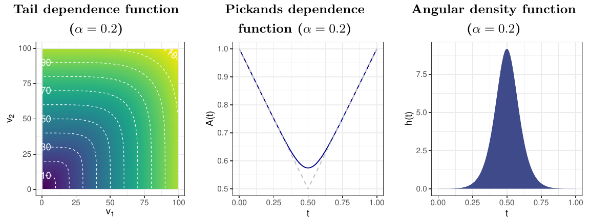
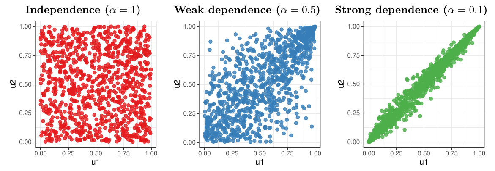



이 글에서는 극단값으로 이루어진 확률벡터에 대한 다변량 극단값 이론을 다룬다. 다차원 극단값 연구는 두 부분으로 이루어진다. 하나는 확률벡터 각 성분의 **주변분포(marginal distribution)** 이고, 다른 하나는 성분들 사이의 **의존 구조(dependence structure)** 이다. 각 주변분포는 [앞 글](1-univariate-extremes.qmd)에서 다룬 일변량 기법으로 분석할 수 있으므로, 여기서는 각 주변분포를 공통 척도로 변환하는 방식에 따라 극단값 의존 구조를 기술하는 두 가지 도구, 즉 **다변량 극단값 분포**와 **극단값 코퓰라**를 소개한다. 단순화를 위해 2차원의 경우에 집중한다. 아래에서 굵은 글씨는 벡터를 나타낸다. 예를 들어 $\mathbf z=(z_1,z_2)$ 이다.

## 다변량 GEV 분포

$(X_1,Y_1),\ldots,(X_n,Y_n)$ 을 $\mathbb R^2$ 에서 독립이고 동일한 분포를 따르는 확률벡터열이라 하자. 각 확률변수는 공통의 표준 프레셰(Fréchet) 주변분포 $F(z)=\exp(-1/z)$, $z>0$ 을 따른다고 가정한다. 성분별 표본 최댓값 $\mathbf M_n=(\max\{X_i/n\},\max\{Y_i/n\})$ 과 퇴화하지 않는 분포함수 $G$ 에 대해

$$
P(\mathbf M_n<\mathbf z)\to G(\mathbf z),\quad \mathbf z\in(0,\infty)^2\quad (n\to\infty)
$$

가 성립하면, $G$ 는 다음 형태의 이변량 극단값 분포이다 (Pickands, 1981).

$$
G(\mathbf z)=\exp\left[-2\int_0^1\max\left\{\frac{w}{z_1},\frac{1-w}{z_2}\right\}H(\mathrm dw)\right],\quad \mathbf z\in(0,\infty)^2.
$$ {#eq-bev}

여기서 $H$ 는 이른바 **각도 측도(angular measure)** 로, 단위구간 $[0,1]$ 위의 확률측도이며 다음 주변 적률 제약(marginal moment constraint)을 만족한다.

$$
\int_0^1 w\,H(\mathrm dw)=\frac12.
$$

자세한 내용은 Coles (2001, 정리 8.1)를 참고하라. 일변량의 경우와 달리, 다변량 GEV 분포는 유한 차원 모수벡터로 색인되는 모수적 분포족으로 표현되지 않는다. 두 극단값이 **독립**인 것은 $H$ 가 단위구간의 양 끝점에 크기 $1/2$ 인 점질량 두 개로 이루어질 때이고 그때뿐이다. 반면 **완전 의존**은 $H$ 가 무게중심 $w=1/2$ 에 단위 점질량을 가질 때이고 그때뿐이다.

### 안정 꼬리 의존 함수

$G$ 의 극단 의존 구조를 표현하는 또 다른 방법은 **안정 꼬리 의존 함수(stable tail dependence function)** (Huang, 1992)를 쓰는 것이다. 안정 꼬리 의존 함수는

$$
l(\mathbf v)=-\log G(1/v_1,1/v_2),\quad \mathbf v\in[0,\infty)^2
$$

로 정의되며 다음 성질을 갖는다.

1. $0<s<\infty$ 에 대해 $l(s\mathbf v)=s\,l(\mathbf v)$
2. $\mathbb R^2$ 의 $j$ 번째 단위벡터 $\mathbf e_j$ 에 대해 $l(\mathbf e_j)=1$, $j=1,2$
3. $\max(v_1,v_2)\le l(\mathbf v)\le v_1+v_2$
4. $\lambda\in[0,1]$ 에 대해 $l\{\lambda\mathbf v+(1-\lambda)\mathbf w\}\le\lambda l(\mathbf v)+(1-\lambda)l(\mathbf w)$

위 성질들은 이변량의 경우를 제외하면 안정 꼬리 의존 함수의 부류를 완전히 특징짓지는 못한다. 하한 $l(\mathbf v)=\max(v_1,v_2)$ 는 완전 의존에, 상한 $l(\mathbf v)=v_1+v_2$ 는 독립에 해당한다.

### Pickands 의존 함수

**Pickands 의존 함수** (Pickands, 1981)도 $G$ 의 의존 구조를 기술하는 데 널리 쓰인다. Pickands 의존 함수 $A:[0,1]\to[1/2,1]$ 은

$$
A(t)=l(1-t,t),\quad t\in[0,1]
$$

로 정의된다. 즉, 안정 꼬리 의존 함수 $l$ 의 정의역을 단위 단체(unit simplex)로 제한한 것이다. $v_1+v_2>0$ 일 때

$$
l(v_1,v_2)=(v_1+v_2)\,A\!\left(\frac{v_2}{v_1+v_2}\right),\quad 0\le v_j<\infty,\ j=1,2
$$

이므로 안정 꼬리 의존 함수 $l$ 은 함수 $A$ 로 완전히 결정된다. $l$ 의 성질로부터 $A$ 는 다음 성질을 갖는다.

1. $\max(1-t,t)\le A(t)\le1$
2. $\lambda\in[0,1]$ 에 대해 $A\{\lambda s+(1-\lambda)t\}\le\lambda A(s)+(1-\lambda)A(t)$, 즉 $A$ 는 볼록함수이다.

하한 $A(t)=\max(1-t,t)$ 는 완전 의존에, $A(t)=1$ 은 독립에 해당한다.

::: {#exm-logistic}
## 로지스틱 모형

다음과 같이 정의되는 꼬리 의존 함수를 생각하자.

$$
l(v_1,v_2)=
\begin{cases}
\left(v_1^{1/\alpha}+v_2^{1/\alpha}\right)^{\alpha}, & 0<\alpha\le1,\\
\max(v_1,v_2), & \alpha=0,
\end{cases}
\qquad (v_1,v_2)\in[0,\infty)^2.
$$

모수 $\alpha$ 는 의존의 정도를 나타내며, 완전 의존($\alpha\to0$)부터 독립($\alpha=1$)까지의 범위를 갖는다. @fig-logistic 은 로지스틱 모형의 의존 구조를 세 가지 방식으로 표현한 것이다.
:::

{#fig-logistic fig-alt="알파 0.2인 로지스틱 모형의 꼬리 의존 함수 등고선, 0.5에서 최솟값을 갖는 V자형 Pickands 의존 함수, 0.5에 봉우리가 있는 각도 밀도 함수."}

## 극단값 코퓰라

표준 프레셰 주변분포 대신, 공통의 균일 주변분포를 갖는 **코퓰라(copula)** 로 다변량 분포함수의 극단 의존 구조를 기술할 수도 있다 (Gudendorf and Segers, 2010). 주변분포 $F_1,\ldots,F_d$ 를 갖는 임의의 다변량 분포 $F$ 에 대해, 단위구간 $[0,1]$ 위의 균일 주변분포를 갖는 분포함수 $C_F$ 가 존재하여

$$
F(\mathbf x)=C_F\{F_1(x_1),F_2(x_2)\},\quad \mathbf x\in\mathbb R^2
$$

를 만족한다 (Sklar, 1959). 이 $C_F$ 를 $F$ 의 코퓰라라고 한다. $F_j$ 가 연속이면 코퓰라 $C_F$ 는 유일하며

$$
C_F(\mathbf u)=F\{F_1^{-1}(u_1),F_2^{-1}(u_2)\},\quad \mathbf u\in[0,1]^2
$$

로 주어진다. 여기서 $F_j^{-1}$ 는 분위함수 $F_j^{-1}(p)=\inf\{x\in\mathbb R:F_j(x)\ge p\}$ 이다. 코퓰라 $C_F$ 가 $(u_1,u_2)\in[0,1]^2$ 에 대해

$$
C_F\left(u_1^{1/n},u_2^{1/n}\right)^n\to C(u_1,u_2)\quad (n\to\infty)
$$ {#eq-evc}

를 만족하면, 극한 $C$ 를 **극단값 코퓰라(extreme-value copula)** 라 한다. @eq-evc 를 만족하는 코퓰라는 모두 어떤 다변량 극단값 분포의 코퓰라이며, 역으로 @eq-bev 의 이변량 극단값 분포의 코퓰라는 모든 $(u_1,u_2)\in[0,1]^2$ 에 대해

$$
C_{EV}(u_1,u_2)=\exp[-l\{-\log(u_1),-\log(u_2)\}]
$$

로 주어진다 (Drees and Huang, 1998). 극단값 코퓰라는 Pickands 의존 함수 $A$ 로도 표현할 수 있다.

$$
C_{EV}(u_1,u_2)=(u_1u_2)^{A\{\log(u_1)/\log(u_1u_2)\}},\quad (u_1,u_2)\in(0,1]^2\setminus\{(1,1)\}.
$$

::: {#exm-gumbel}
## 로지스틱 모형 (계속): 검벨 코퓰라

로지스틱 의존 구조에 대응하는 극단값 코퓰라는 다음 형태의 **검벨 코퓰라(Gumbel copula)** 이다.

$$
C_{EV}(u_1,u_2)=\exp\left[-\left\{(-\log u_1)^{1/\alpha}+(-\log u_2)^{1/\alpha}\right\}^{\alpha}\right].
$$

여기서도 모수 $\alpha$ 는 완전 의존($\alpha\to0$)부터 독립($\alpha=1$)까지의 의존 정도를 나타낸다. 검벨 코퓰라는 가장 오래된 다변량 극단값 모형 가운데 하나이며, 아르키메데스(Archimedean) 코퓰라이면서 동시에 극단값 코퓰라인 유일한 코퓰라로 알려져 있다 (Genest and Rivest, 1989). @fig-gumbel 은 의존 정도가 다른 세 이변량 검벨 코퓰라의 예이다.
:::

{#fig-gumbel fig-alt="검벨 코퓰라에서 뽑은 세 산점도. 알파가 1이면 점이 단위정사각형에 고르게 퍼지고, 0.5이면 오른쪽 위 모서리에 몰리며, 0.1이면 대각선을 따라 촘촘히 모인다."}

## 비정상 다변량 극단값

다변량 극단값을 모형화하는 통계적 방법은 Tawn (1988)이 이변량 극단값 분포의 모형화를 도입한 이후 발전해 왔다. 다변량 극단값 분포의 각도 측도는 결합 수준에서 극단 의존을 통계적으로 모형화하는 핵심 대상이다. 다변량 극단값 분포는 모수적 표현이 무한히 많기 때문에, 대부분의 문헌은 준모수적(semi-parametric) 접근으로 극단 의존 구조를 추정하는 데 초점을 맞추어 왔다.

최근에는 결합 극단값의 의존 구조에 비정상성을 반영하는 연구들이 나왔다. 기울임 함수(tilting function)를 이용한 극단값 분포족 (de Carvalho and Davison, 2014), 공변량에 따라 변하는 스펙트럼 밀도 (Castro and de Carvalho, 2017), 공변량을 반영한 Pickands 의존 함수 (Mhalla et al., 2017), 시변 코퓰라 (Gong and Huser, 2022) 등이다. de Carvalho (2016)가 모형화 대상으로 예측변수에 의존하는 각도 밀도족인 **각도 곡면(angular surface)** 을 제안한 이후, Castro et al. (2018)은 이변량 환경에서 커널 회귀 추정량을 제안하여 주요 주가지수의 의존 구조를 분석하였고, Mhalla et al. (2019a)은 극한 기온 자료에 벌점 B-스플라인에 기반한 GAM형 추정량을 개발하였다.

다음 글부터는 이러한 비정상 극단값 모형의 추론에 필요한 도구로서 베이지안 평활 기법을 살펴본다.

## 주요 참고문헌

- Castro, D. and de Carvalho, M. (2017). Spectral density regression for bivariate extremes. *Stochastic Environmental Research and Risk Assessment*, 31, 1603–1613.
- Castro, D., de Carvalho, M. and Wadsworth, J. L. (2018). Time-varying extreme value dependence with application to leading European stock markets. *The Annals of Applied Statistics*, 12, 283–309.
- Coles, S. (2001). *An Introduction to Statistical Modeling of Extreme Values*. Springer.
- de Carvalho, M. (2016). Statistics of extremes: Challenges and opportunities. In F. Longin (ed.), *Extreme Events in Finance*. Wiley.
- de Carvalho, M. and Davison, A. C. (2014). Spectral density ratio models for multivariate extremes. *Journal of the American Statistical Association*, 109, 764–776.
- Drees, H. and Huang, X. (1998). Best attainable rates of convergence for estimators of the stable tail dependence function. *Journal of Multivariate Analysis*, 64, 25–46.
- Genest, C. and Rivest, L.-P. (1989). A characterization of Gumbel's family of extreme value distributions. *Statistics & Probability Letters*, 8, 207–211.
- Gong, Y. and Huser, R. (2022). Asymmetric tail dependence modeling, with application to cryptocurrency market data. *The Annals of Applied Statistics*.
- Gudendorf, G. and Segers, J. (2010). Extreme-value copulas. In *Copula Theory and Its Applications*, Springer, 127–145.
- Huang, X. (1992). *Statistics of Bivariate Extreme Values*. Thesis Publishers, Amsterdam.
- Mhalla, L., Chavez-Demoulin, V. and Naveau, P. (2017). Non-linear models for extremal dependence. *Journal of Multivariate Analysis*, 159, 49–66.
- Mhalla, L., de Carvalho, M. and Chavez-Demoulin, V. (2019a). Regression-type models for extremal dependence. *Scandinavian Journal of Statistics*, 46, 1141–1167.
- Pickands, J. (1981). Multivariate extreme value distributions. *Proceedings of the 43rd Session of the International Statistical Institute*.
- Sklar, M. (1959). Fonctions de répartition à n dimensions et leurs marges. *Publications de l'Institut de Statistique de l'Université de Paris*, 8, 229–231.
- Tawn, J. A. (1988). Bivariate extreme value theory: models and estimation. *Biometrika*, 75, 397–415.
