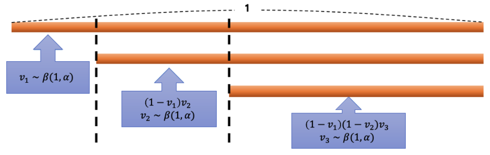
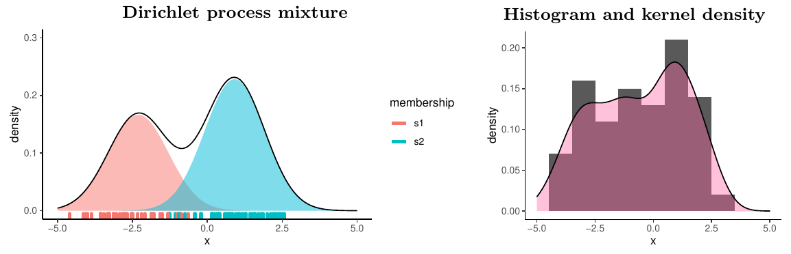



비모수 베이즈 방법은 제한적인 모수 가정 없이 완전한 확률적 기술을 바탕으로 유연한 모형화를 가능하게 한다. 이 글과 [다음 글](6-bernstein-polynomials.qmd)에서는 **디리클레 과정(Dirichlet process)** 에 기반한 베이지안 비모수 방법의 요소를 밀도추정 추론을 중심으로 정리한다 (Ghosh and Ramamoorthi, 2003; Müller et al., 2015; Ghosal and Van der Vaart, 2015). 이 글에서는 기본 개념과 기법을 소개하고, 다음 글에서 유계 영역 위의 랜덤 번스타인 다항식(Petrone, 1999a,b)을 소개한다.

통계 문제는 관측값 위에 세운 확률모형으로 기술할 수 있다. 확률표본을 바탕으로 미지의 분포 $G$ 를 추론하고 밀도를 추정하는 문제를 생각하자.

$$
y_i\mid F\overset{\text{i.i.d.}}{\sim}F,\quad i=1,\ldots,n.
$$ {#eq-iid}

관측값이 어떤 분포 $F$ 에서 독립적으로 뽑혔다고 가정하면, 통계 문제는 분포 $F$ 에 대한 추론으로 귀결된다. $\Theta$ 를 모수공간, $f_{\boldsymbol\theta}$ 를 모수 $\boldsymbol\theta\in\Theta$ 를 갖는 확률밀도함수라 하자. 그러면 $f_{\boldsymbol\theta}$ 는 밀도족 $\mathcal F=\{f_{\boldsymbol\theta}:\boldsymbol\theta\in\Theta\}$ 에 속한다. 모수 $\boldsymbol\theta$ 가 유한 차원이면 그 통계모형을 **모수적(parametric) 모형**이라 하고, 그렇지 않으면 **비모수적(nonparametric) 모형**이라 한다.

일반적으로 유한 차원 모수 가정을 완화하면 더 유연하고 강건한 모형화가 가능하며, 분포족 $\mathcal F$ 를 잘못 지정해서 생기는 편향을 피할 수 있다. 비모수 모형의 베이지안 추론은 사전분포를 구성하는 데서 시작하며, 무한 차원 모수에 대한 모든 불확실성을 아우르는 완전히 확률적인 접근을 취한다. 아래에서는 무한 차원 모수공간 위의 사전분포, 즉 분포함수들의 모임 위에 정의된 랜덤 확률측도를 소개한다.

## 디리클레 과정

미지의 분포 $F$ 에 대한 사전분포, 더 구체적으로 무한 차원 모수공간을 갖는 확률모형 $\pi$ 를 구성할 때 널리 쓰이는 선택은 **디리클레 과정**이라는 이산 랜덤 확률측도이다 (Ferguson, 1973).

$G$ 를 공간 $\mathcal S$ 위의 확률측도라 하자. 모수 $(\alpha,G_0)$ 를 갖는 디리클레 과정은 $\mathcal S$ 위의 랜덤 확률측도 $G$ 로서, $\mathcal S$ 의 임의의 유한 분할 $\{B_1,\ldots,B_k\}$ (각 $B_j$ 는 가측집합)에 대해 벡터 $(G(B_1),\ldots,G(B_k))$ 의 결합분포가 모수 $(\alpha G_0(B_1),\ldots,\alpha G_0(B_k))$ 를 갖는 디리클레 분포가 되는 것으로 정의된다. 그 밀도는 단체 $\{(G(B_1),\ldots,G(B_k)):G(B_j)\ge0,\ \sum_jG(B_j)=1\}$ 위에서

$$
f(G(B_1),\ldots,G(B_k))=\frac{\Gamma(\alpha)}{\prod_{j=1}^k\Gamma(\alpha G_0(B_j))}\prod_{j=1}^kG(B_j)^{\alpha G_0(B_j)-1}
$$

이다. 여기서 $\alpha>0$ 을 **집중 모수(concentration parameter)**, $G_0$ 를 **기저 측도(base measure)** 라 하며, 모수 $(\alpha,G_0)$ 를 갖는 디리클레 과정을 $\mathrm{DP}(\alpha,G_0)$ 로 표기한다.

### 막대 꺾기 표현

Sethuraman (1994)은 디리클레 과정의 구성적 정의를 다음과 같이 제안하였다.

$$
G(\cdot)=\sum_{h=1}^\infty w_h\,\delta_{m_h}(\cdot).
$$

여기서 $w_1,w_2,\ldots$ 는 확률 가중치이고 $\delta_x(\cdot)$ 는 디랙(Dirac) 측도이다. $m_h$ 는 $G_0$ 에서 i.i.d.로 뽑고, $w_h$ 는 남은 길이 $\{1-\sum_{l<h}w_l\}$ 의 일부로 정한다. 즉, 가중치 $w_h$ 와 위치 $m_h$ 는

$$
w_h=v_h\prod_{l<h}(1-v_l),\quad v_h\overset{\text{i.i.d.}}{\sim}\mathrm{Beta}(1,\alpha),\quad m_h\overset{\text{i.i.d.}}{\sim}G_0
$$

로 얻으며, $v_h$ 와 $m_h$ 는 서로 독립이다. @fig-stick 처럼 가중치 $w_h$ 는 처음 길이가 1인 막대에서 일정 비율씩 차례로 꺾어 낸 조각에 해당하며, 각 조각이 위치 $m_h$ 에 할당된다.

{#fig-stick fig-alt="길이 1의 막대에서 첫 조각 v1을 떼어 내고, 남은 막대에서 (1-v1)v2, 다시 (1-v1)(1-v2)v3를 차례로 떼어 내는 그림."}

### 디리클레 과정의 성질

디리클레 과정 사전분포는 좋은 통계적 성질을 갖는다. 우선 이산 랜덤 분포를 생성한다. 또한 디리클레 과정은 **넓은 약 지지(large weak support)** 를 갖는다. 즉, $G_0$ 와 지지집합이 같은 어떤 분포도 디리클레 과정이 유도하는 확률측도로 약하게(weakly) 잘 근사할 수 있다. 분포 $Q$ 가 기저 측도 $G_0$ 아래에서 확률이 0인 사건에 양의 확률을 주지 않는다면, 임의의 유한개 $B_1,\ldots,B_k$ 와 모든 $\varepsilon>0$ 에 대해

$$
\pi\{|G(B_j)-Q(B_j)|<\varepsilon,\ j=1,\ldots,k\}>0
$$

이 성립한다 (Ferguson, 1973, 명제 3). 다시 말해 랜덤 확률측도 $G$ 는 집합 $B_j$ 위에서 $Q$ 에 약한 의미로 임의로 가까워질 수 있다. 유한 차원 디리클레 과정 사전분포에서도 마찬가지이며, $\pi(G(B)>0)=1$ 은 $G_0(B)>0$ 일 때이고 그때뿐이다.

또한 집합 $B$ 의 평균과 분산은 디리클레 분포로부터 얻을 수 있다. 분할 $\{B,B^c\}$ 에서 $G_0(B^c)=1-G_0(B)$ 이므로, 임의의 집합 $B$ 에 대해

$$
E[G(B)]=G_0(B),\qquad \mathrm{Var}[G(B)]=\frac{G_0(B)\{1-G_0(B)\}}{1+\alpha}
$$

이다. 집중 모수 $\alpha$ 가 클수록 $G$ 가 기저 측도 $G_0$ 주위에 더 집중된다.

### 사후분포

디리클레 과정 사전분포는 i.i.d. 관측 모형에 대해 **켤레**이다. @eq-iid 의 표본 모형에서 $G$ 에 디리클레 과정 사전분포를 주면, $G$ 의 사후분포도 디리클레 과정이다. 사후 디리클레 과정의 기저 측도는 사전 기저 측도에 각 관측점 $y_i$ 의 점질량을 더한 것으로, 사전 기저 측도 $G_0$ 와 경험분포 $\hat f(\cdot)=\frac1n\sum_{i=1}^n\delta_{y_i}(\cdot)$ 의 가중평균이 된다. 사후 총질량은 $\alpha+n$ 으로 늘어난다.

::: {#thm-dp-posterior}
## i.i.d. 관측값에 대한 디리클레 과정 사전분포의 사후분포

$y_1,\ldots,y_n$ 이 분포 $G$ 의 확률표본, 즉 $y_1,\ldots,y_n\mid G\overset{\text{i.i.d.}}{\sim}G$ 이고 $G\sim\mathrm{DP}(\alpha G_0)$ 라 하자. 그러면 $G$ 의 사후분포는 다음 디리클레 과정이다.

$$
G\mid y_1,\ldots,y_n\sim\mathrm{DP}\left(\alpha G_0+\sum_{i=1}^n\delta_{y_i}\right).
$$
:::

증명은 Ferguson (1973, 정리 1)을 참고하라. 여기서 $\mathrm{DP}(\alpha G_0)$ 는 총질량 $\alpha$ 와 정규화된 기저 측도 $G_0$ 를 한데 묶은 측도 $\alpha G_0$ 로 디리클레 과정을 표기한 것이다.

### 폴리아 항아리 표현

관측값 $y_1,\ldots,y_n$ 의 주변분포는 $G$ 에 대해 적분하여

$$
P(y_1,\ldots,y_n)=\int\prod_{i=1}^n f_G(y_i)\,\mathrm dG
$$

로 얻는다. 그러나 주변분포에서 표본을 뽑을 때는 다른 방법이 유용하다. **폴리아 항아리(Pólya urn) 표현**은 주변분포를 차례로 이어지는 조건부 확률의 곱으로 나타낸다.

$$
\begin{aligned}
P(y_1,\ldots,y_n)&=P(y_1)\prod_{i=2}^nP(y_i\mid y_1,\ldots,y_{i-1}),\\
P(y_i\mid y_1,\ldots,y_{i-1})&=\frac{1}{\alpha+i-1}\sum_{h=1}^{i-1}\delta_{y_h}(y_i)+\frac{\alpha}{\alpha+i-1}G_0(y_i),\quad i=2,3,\ldots
\end{aligned}
$$

여기서 $y_1\sim G_0$ 이다. $y_{n+1}$ 의 사후 예측분포는 다음과 같다.

$$
P(y_{n+1}\mid y_1,\ldots,y_n)=\frac{1}{\alpha+n}\sum_{h=1}^n\delta_{y_h}(y_{n+1})+\frac{\alpha}{\alpha+n}G_0(y_{n+1}).
$$

즉, 새 관측값은 확률 $n/(\alpha+n)$ 으로 이미 관측된 값 가운데 하나와 같아지고, 확률 $\alpha/(\alpha+n)$ 으로 기저 측도 $G_0$ 에서 새로 뽑힌다.

## 디리클레 과정 혼합

디리클레 과정 사전분포는 이산분포를 생성하므로, 연속분포의 밀도추정에는 그대로 쓰기에 적합하지 않다. 그러나 디리클레 과정을 단순한 모수적 밀도(커널) 위의 혼합에서 **혼합 측도(mixing measure)** 로 쓰면 밀도추정에도 적용할 수 있다.

$\Theta$ 를 유한 차원 모수공간, $f_{\boldsymbol\theta}$ 를 모든 $\boldsymbol\theta\in\Theta$ 에 대해 연속인 밀도함수라 하자. 공간 $\Theta$ 위의 분포 $G$ 가 주어지면, **디리클레 과정 혼합(Dirichlet process mixture, DPM)** 은 밀도 $f_{\boldsymbol\theta}$ 들의 다음 혼합이다.

$$
f_G(y)=\int f_{\boldsymbol\theta}(y)\,\mathrm dG(\boldsymbol\theta).
$$ {#eq-dpm}

디리클레 과정 혼합 모형은 풍부한 연속 밀도함수족을 만든다. 모수 $\boldsymbol\theta=(\mu,\sigma)$ 를 갖는 어떤 고정된 밀도 $g$ 에 대해, $\sigma\to0$ 을 허용하면 조정된 밀도 $f_{\boldsymbol\theta}(y)=\sigma^{-1}g((y-\mu)/\sigma)$ 들의 혼합으로 임의의 밀도를 $L_1$ 의미에서 근사할 수 있기 때문이다 (Lo, 1984). @eq-dpm 의 디리클레 과정 혼합은 다음 계층 형태로도 나타낼 수 있다.

$$
y_i\mid\theta_i\overset{\text{ind}}{\sim}f_{\theta_i},\quad \theta_i\mid G\overset{\text{i.i.d.}}{\sim}G,\quad G\sim\mathrm{DP}(\alpha,G_0).
$$ {#eq-dpm-hier}

계층모형을 $\theta_i$ 에 대해 적분하여 주변화하면 @eq-dpm-hier 는 @eq-dpm 의 혼합모형과 같다. 이 표현에서 $G$ 의 사후분포 $P(G\mid\mathbf y)$ 는 잠재변수 $\theta_i$ 에 대해 혼합한 디리클레 과정들의 혼합으로 볼 수 있다. 따라서 디리클레 과정 혼합의 사후분포를 얻는 데에도 디리클레 과정의 혼합에 대한 표본추출 기법을 쓸 수 있으며, 그 결과로 얻는 분포는 같다.

::: {#thm-mdp-posterior}
## i.i.d. 관측값에 대한 디리클레 과정 혼합의 사후분포

$\mathbf y=(y_1,\ldots,y_n)$, $\boldsymbol\theta=(\theta_1,\ldots,\theta_n)$ 이라 하자. $i=1,\ldots,n$ 에 대해 $y_i\mid\theta_i\overset{\text{ind}}{\sim}f_{\theta_i}$, $\theta_i\overset{\text{i.i.d.}}{\sim}G$ 이고 $G\sim\mathrm{DP}(\alpha,G_0)$ 이면, $\mathbf y$ 가 주어졌을 때 $G$ 의 사후분포는

$$
G\mid\mathbf y\sim\int\mathrm{DP}\left(\alpha G_0+\sum_{i=1}^n\delta_{\theta_i}\right)\mathrm dp(\boldsymbol\theta\mid\mathbf y)
$$

이다.
:::

증명은 Antoniak (1974, 정리 3)을 참고하라.

### 랜덤 분할과 군집화

디리클레 과정의 이산성 때문에 잠재변수 $\theta_i$ 들 사이에 같은 값(tie)이 나올 확률이 양수이다. $j=1,\ldots,k$ ($k\le n$)에 대해 $\theta_j^*$ 를 $\theta_i$ 의 서로 다른 값들, $S_j=\{i:\theta_i=\theta_j^*\}$ 를 $j$ 번째 군집에 속한 첨자 $i$ 들의 집합이라 하자. $n_j=|S_j|$ 는 $\theta_j^*$ 와 같은 값을 갖는 $\theta_i$ 의 개수이고, $\rho_n=\{S_1,\ldots,S_k\}$ 는 실험 단위 집합 $\{1,\ldots,n\}$ 의 분할이다.

디리클레 과정 혼합 모형은 실험 단위의 랜덤 분할 $\rho_n$ 에 대한 모형을 함께 만든다. $\rho_n$ 의 확률모형은 구성 과정에서 우연히 생긴 부산물처럼 보이지만, **중국 식당 과정(Chinese restaurant process)** 이라 불리는 이 분할에 초점을 맞춘 응용이 많다. 랜덤 분할의 사후분포 $P(\rho_n\mid\mathbf y)$ 는 관측값 $\mathbf y$ 의 군집화에 대한 추론을 보여 준다.

군집 소속 지시변수 $s$ 를 $i\in S_j$ 이면 $s_i=j$ 로 정의하자. 지시변수는 등장 순서대로 붙인다. 즉, $s_1=1$, $\theta_{i_2}\ne\theta_1$ 인 가장 작은 $i_2>1$ 에 대해 $s_{i_2}=2$, $\theta_{i_3}\notin\{\theta_1,\theta_2\}$ 인 가장 작은 $i_3>i_2$ 에 대해 $s_{i_3}=3$, 이런 식이다. 그러면 $s_1,\ldots,s_{i-1}$ 이 주어졌을 때 $s_i$ 의 조건부 확률은

$$
P(s_i=j\mid s_1,\ldots,s_{i-1})=
\begin{cases}
\dfrac{n_{i-1,j}}{\alpha+i-1}, & j=1,\ldots,k_{i-1},\\[2ex]
\dfrac{\alpha}{\alpha+i-1}, & j=k_{i-1}+1
\end{cases}
$$

이다. 여기서 $k_{i-1}$ 은 $\{\theta_1,\ldots,\theta_{i-1}\}$ 가운데 서로 다른 값의 개수이고, $n_{i-1,j}$ 는 그중 $j$ 번째 값을 갖는 것의 개수이다. $\theta_i$ 들의 교환가능성(exchangeability)에 의해, 조건부 확률 $P(s_i\mid s_{-i})$ 도 $i=n$ 인 경우와 같은 형태를 갖는다.

$$
P(s_i\mid s_{-i})=P(\theta_i\mid\theta_{-i})\propto\sum_{j=1}^{k^-}n_j^-\,\delta_{\theta_j^{*-}}(\theta_i)+\alpha\,G_0(\theta_i),\quad i=1,\ldots,n.
$$

여기서 $\theta_{-i}$ 는 $\boldsymbol\theta$ 에서 $i$ 번째 원소 $\theta_i$ 를 뺀 것이고, $k^-$ 는 $\theta_{-i}$ 의 서로 다른 값의 개수, $\theta_j^{*-}$ 는 그 $j$ 번째 값, $n_j^-$ 는 $j$ 번째 값을 갖는 원소의 개수이다. 사후분포 $P(G\mid\mathbf y)$ 는 각 관측값의 군집 소속을 표본추출하여 모의할 수 있다.

::: {#exm-dpm-gauss}
## 가우스 커널을 쓰는 디리클레 과정 혼합

가우스 커널을 쓰는 디리클레 과정 혼합은 다음과 같다.

$$
y_i\mid\theta_i\overset{\text{ind}}{\sim}N(\theta_i,\sigma^2),\quad \theta_i\mid G\overset{\text{i.i.d.}}{\sim}G,\quad G\sim\mathrm{DP}(\alpha,G_0),\quad G_0:=N(\mu_0,\sigma_0^2).
$$

관측값 $y_i$ 는 평균 $\theta_i$, 분산 $\sigma^2$ 인 가우스 밀도 가운데 하나에서 뽑힌 것으로 볼 수 있다. @fig-dpm 은 $\theta_1=-2.3$, $\theta_2=0.91$, $\sigma^2=1$ 일 때 각 관측값의 군집화를 보여 준다. 모형은 각 관측값에 군집 소속 $s_i$ 를 부여하고, 그 군집화가 혼합모형의 가중치를 결정한다.
:::

{#fig-dpm fig-alt="왼쪽은 -2.3과 0.91 부근을 중심으로 하는 두 가우스 성분과 그 혼합 밀도, 아래 러그는 두 군집으로 색이 나뉜 관측값이다. 오른쪽은 같은 자료의 히스토그램과 커널밀도 곡선이다."}

## 주요 참고문헌

- Antoniak, C. E. (1974). Mixtures of Dirichlet processes with applications to Bayesian nonparametric problems. *The Annals of Statistics*, 2, 1152–1174.
- Ferguson, T. S. (1973). A Bayesian analysis of some nonparametric problems. *The Annals of Statistics*, 1, 209–230.
- Ghosal, S. and Van der Vaart, A. W. (2015). *Fundamentals of Nonparametric Bayesian Inference*. Cambridge University Press.
- Ghosh, J. K. and Ramamoorthi, R. V. (2003). *Bayesian Nonparametrics*. Springer.
- Lo, A. Y. (1984). On a class of Bayesian nonparametric estimates: I. Density estimates. *The Annals of Statistics*, 12, 351–357.
- Müller, P., Quintana, F. A., Jara, A. and Hanson, T. (2015). *Bayesian Nonparametric Data Analysis*. Springer.
- Sethuraman, J. (1994). A constructive definition of Dirichlet priors. *Statistica Sinica*, 4, 639–650.
