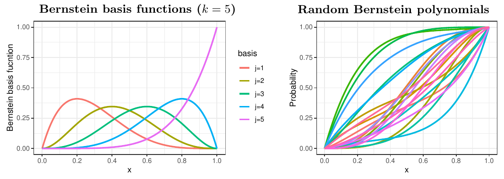



[앞 글](5-dirichlet-process-mixtures.qmd)의 디리클레 과정 혼합은 실수 전체에서 정의된 밀도를 추정하는 데 쓰였다. 그러나 [극단값 이론](1-univariate-extremes.qmd)에서 다루는 스케다시스 밀도나 [각도 밀도](2-multivariate-extremes.qmd)처럼 관심 대상이 단위구간 $[0,1]$ 같은 **유계 영역** 위의 분포인 경우가 많다. **랜덤 번스타인 다항식(random Bernstein polynomials)** 은 유계 지지집합 위의 분포함수 공간에 사전분포를 주는 랜덤 확률측도이다 (Petrone, 1999a,b; Petrone and Wasserman, 2002).

## 번스타인 다항식

폐구간 $[0,1]$ 위의 연속함수 $G$ 가 주어졌을 때, $G$ 의 $k$ 차 번스타인 다항식은

$$
B(y;k,G)=\sum_{j=0}^kG\!\left(\frac jk\right)\binom kj y^j(1-y)^{k-j}
$$

로 정의된다. 각 항은 번스타인 계수 $G(j/k)$ 와 번스타인 다항식 기저함수의 곱이다. $[0,1]$ 에서 유계인 함수 $G(y)$ 에 대해

$$
\lim_{k\to\infty}B(y;k,G)=G(y)
$$

가 $G$ 의 모든 연속점 $y$ 에서 성립하고, $G$ 가 연속이면 균등하게 성립한다 (자세한 내용은 Lorentz, 1986 참고).

$G$ 와 $k$ 가 확률적이면 번스타인 다항식 $B(\cdot;k,G)$ 는 랜덤 확률측도 $\pi$ 를 생성하며, 이를

$$
\pi\sim\Pi(k,G)
$$

로 표기한다. $G(0)=0$ 이면 번스타인 다항식의 도함수는 다음과 같은 **베타 밀도의 혼합**이다.

$$
b(y;k,G)=\sum_{j=1}^kw_{j,k}\,\beta(y;j,k-j+1).
$$ {#eq-bernstein-density}

여기서 $w_{j,k}=G(j/k)-G((j-1)/k)$, $j=1,\ldots,k$ 이고, $\beta(\cdot;a,b)$ 는 모수 $a$, $b$ 를 갖는 베타 밀도이다. 차수 $k$ 는 혼합에 쓰이는 베타 성분의 개수를, 가중치 $w_{j,k}$ 는 각 소구간 $((j-1)/k,j/k]$ 에 $G$ 가 주는 확률을 뜻한다.

{#fig-bernstein fig-alt="왼쪽은 0과 1 사이에서 봉우리 위치가 차례로 오른쪽으로 옮겨 가는 5개의 번스타인 기저함수, 오른쪽은 0에서 0, 1에서 1을 지나는 여러 개의 랜덤 누적분포함수 경로."}

## 번스타인–디리클레 사전분포

$\pi$ 를 번스타인 다항식이 유도하는 확률측도라 하자. $k$ 가 양의 정수 위의 확률질량함수 $p(k)$ 를 따르는 확률변수이고, $G$ 가 디리클레 과정 $\mathrm{DP}(\alpha,G_0)$ 에서 유도된 랜덤 분포함수, 즉

$$
\pi\sim\Pi(k,G),\quad G\sim\mathrm{DP}(\alpha,G_0)
$$

이면, $\pi$ 를 **번스타인–디리클레 사전분포(Bernstein–Dirichlet prior, BDP)** $\pi(p,\alpha G_0)$ 라 한다. 디리클레 과정의 넓은 약 지지 성질과 마찬가지로, $\pi$ 도 완전한 약 지지를 가짐을 보일 수 있다. $[0,1]$ 위의 임의의 연속분포 $Q$ 와 $\varepsilon>0$ 에 대해

$$
\pi\left(\left\{G:\sup_x|G(x)-Q(x)|<\varepsilon\right\}\right)>0
$$

이다.

## 계층모형과 잠재변수

추론을 위해 다음 계층모형을 생각하자.

$$
\begin{aligned}
k&\sim p(k),\quad G\mid k\sim\mathrm{DP}(\alpha,G_0),\\
\mathbf W\mid k,G&\sim\mathrm{Dir}(a_{1,k},\ldots,a_{k,k}),\\
Y_i\mid k,\mathbf W&\overset{\text{i.i.d.}}{\sim}b(y;k,G).
\end{aligned}
$$

여기서 $\mathbf W=(W_{1,k},\ldots,W_{k,k})$ 이고, $\mathrm{Dir}$ 은 모수 $(a_{1,k},\ldots,a_{k,k})$ 를 갖는 디리클레 분포이며 $a_{j,k}=\alpha\{G_0(j/k)-G_0((j-1)/k)\}$ 이다.

그러나 $(k,\mathbf W_k\mid y_1,\ldots,y_n)$ 의 사후분포는 일반적으로 계산하기 어렵다. 그래서 보조 확률변수 $(Z_1,\ldots,Z_n)$ 을 도입하여 계층모형에 단계를 하나 더 둔다.

$$
Y_i\mid Z_i\sim\beta(y;j,k-j+1)\quad\text{if}\quad Z_i\in\left(\frac{j-1}{k},\frac jk\right],\quad j=1,\ldots,k.
$$

보조변수 $Z_i$ 는 $Y_i$ 가 @eq-bernstein-density 의 혼합에서 어느 성분으로부터 나왔는지를 나타낸다. 수정된 계층모형은 다음과 같다.

$$
\begin{aligned}
k&\sim p(k),\quad G\mid k\sim\mathrm{DP}(\alpha,G_0),\\
Z_i\mid k,G&\overset{\text{i.i.d.}}{\sim}G,\quad i=1,\ldots,n,\\
Y_1,\ldots,Y_n\mid k,G,Z_1,\ldots,Z_n&\sim\prod_{i=1}^n\sum_{j=1}^k\beta(y_i;j,k-j+1)\,\mathbb 1_{((j-1)/k,\,j/k]}(Z_i).
\end{aligned}
$$

이렇게 하면 잠재변수 $Z_i$ 가 주어졌을 때 $G$ 의 조건부 분포는 [앞 글](5-dirichlet-process-mixtures.qmd)의 디리클레 과정 사후분포 결과를 그대로 쓸 수 있고, $k$ 와 $Z_i$ 는 깁스 샘플링으로 차례로 갱신할 수 있다.

## 주요 참고문헌

- Lorentz, G. G. (1986). *Bernstein Polynomials*. Chelsea Publishing Company.
- Petrone, S. (1999a). Bayesian density estimation using Bernstein polynomials. *Canadian Journal of Statistics*, 27, 105–126.
- Petrone, S. (1999b). Random Bernstein polynomials. *Scandinavian Journal of Statistics*, 26, 373–393.
- Petrone, S. and Wasserman, L. (2002). Consistency of Bernstein polynomial posteriors. *Journal of the Royal Statistical Society: Series B*, 64, 79–100.
