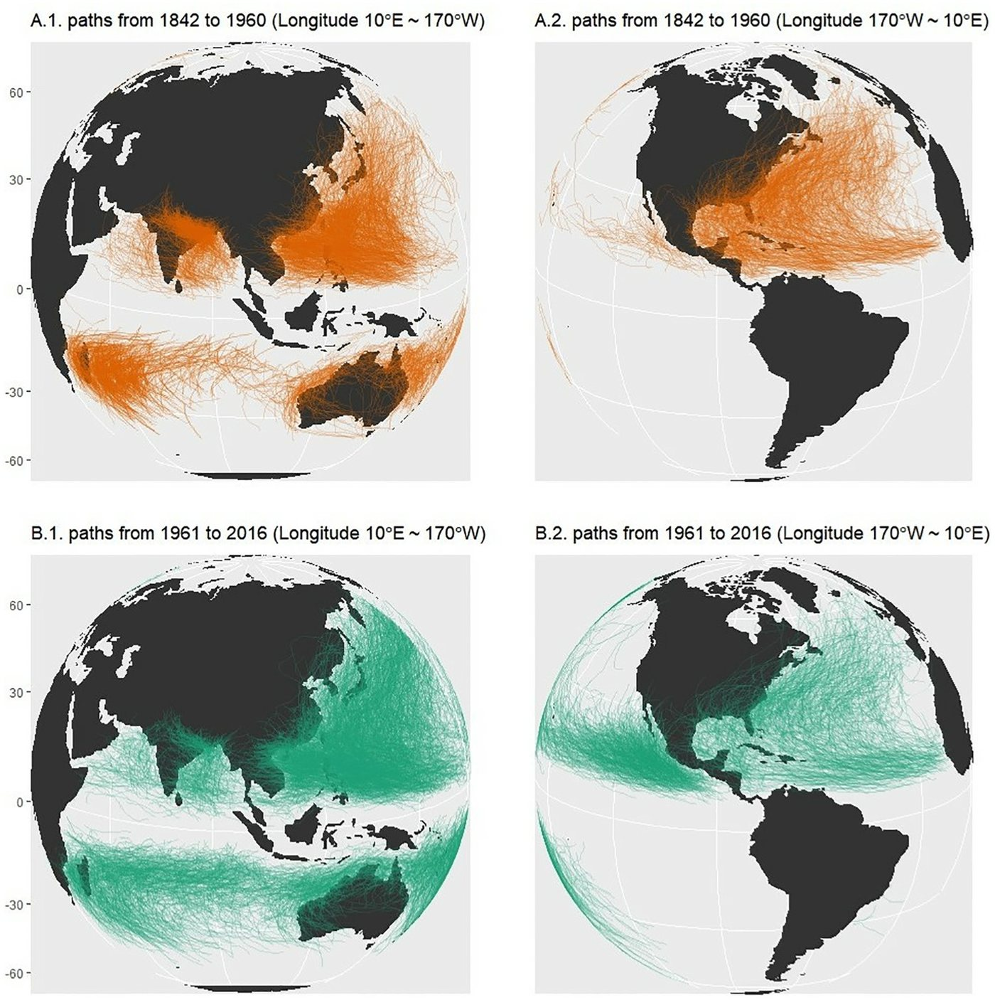
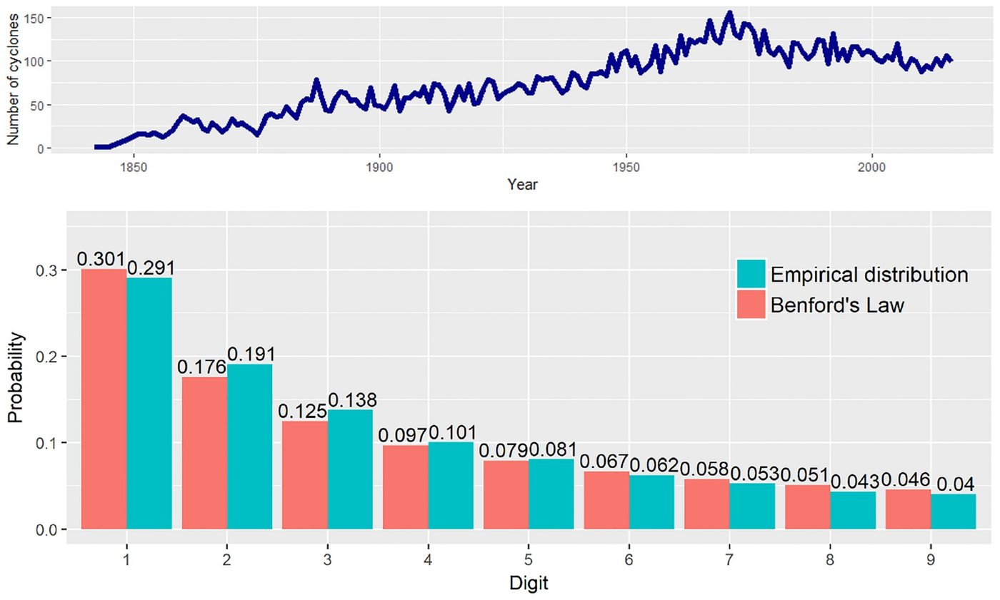
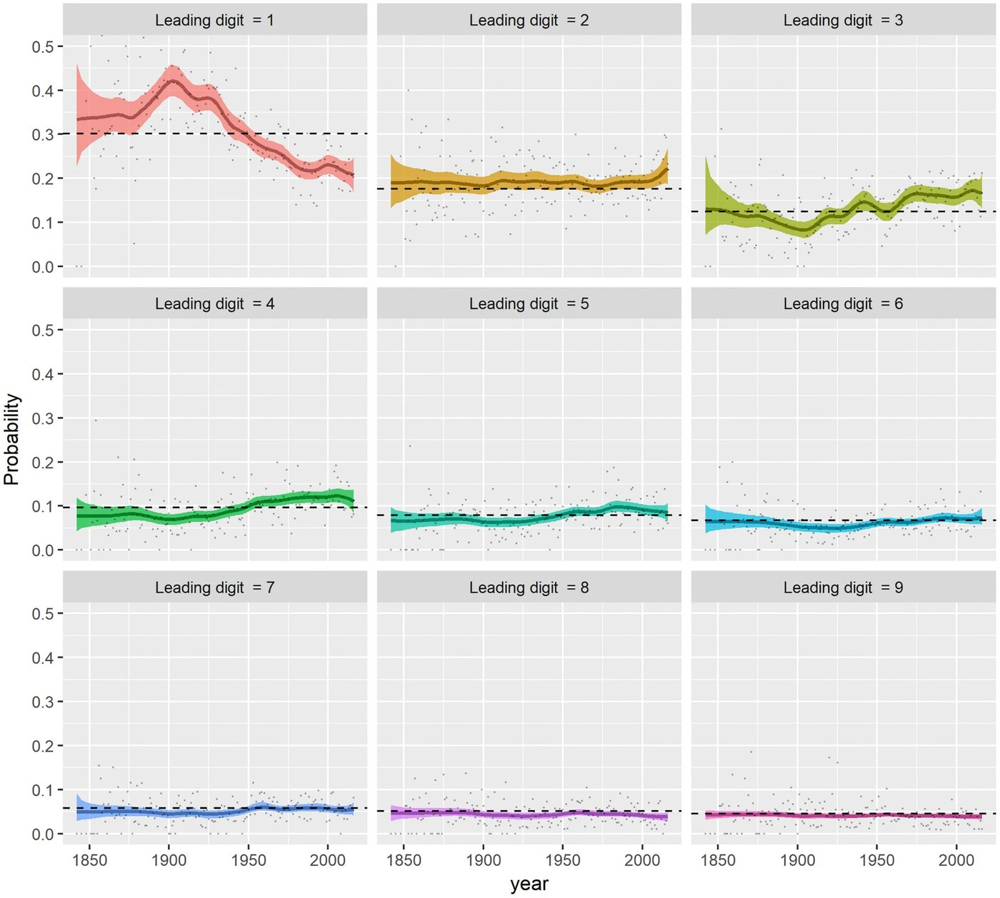
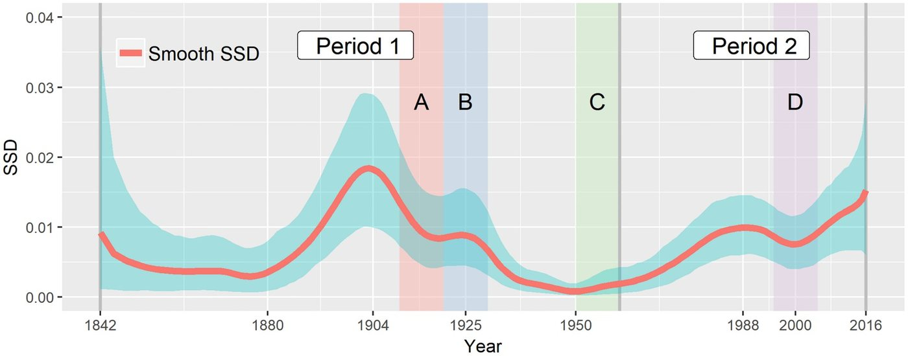
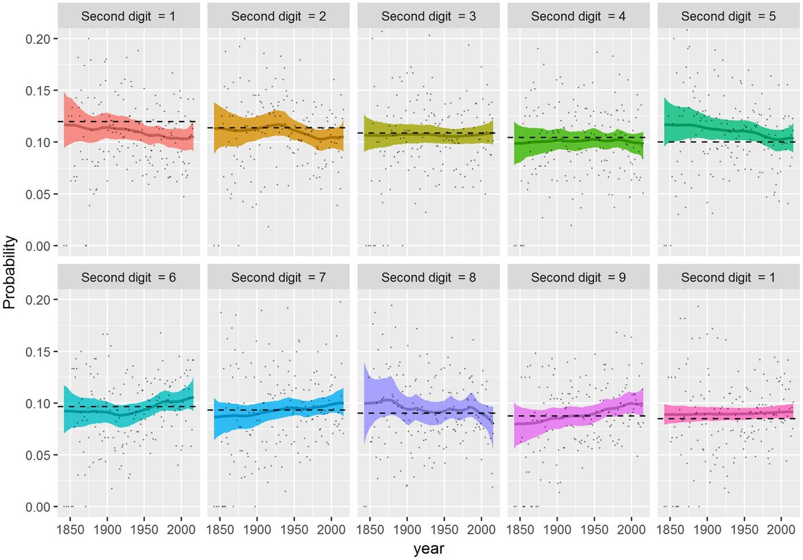
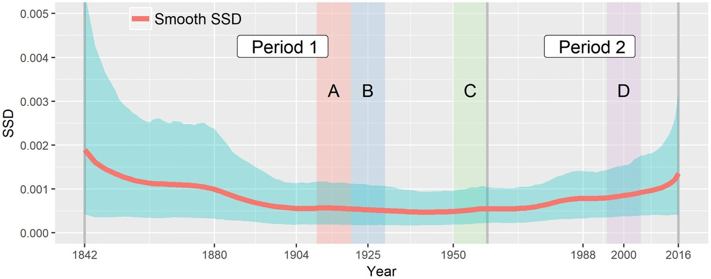

```{=html}
<div class="wt"><div class="wt-grid">
<div class="wt-main">

<div class="hero" id="summary">
  <div class="byline">이준호, Miguel de Carvalho(University of Edinburgh)</div>
  <p class="lead">관측 기술이 좋아지면 자료도 계속 고르고 믿을 만해질까? 1842년부터 2016년까지 전 세계 열대저기압(태풍, 허리케인 등)의 이동 거리 첫 자리 숫자가 벤포드 법칙에 얼마나 맞는지를 해마다 추적하는 베이즈 모형을 만들어 이 질문을 살펴보았다.</p>
  <div class="verdict"><b>한 줄 결론</b> — 벤포드 법칙과의 어긋남은 일정하지 않고 큰 주기를 보였다. 1903년 무렵 가장 컸다가 1950년 무렵 가장 작아졌고, <b>1970년대 이후 다시 커졌다</b>. 기술은 누적되는데도 어긋남이 다시 늘었으므로, 기술 발전의 영향은 제한적이었고 <b>다른 요인이 있을 수 있다</b>는 시사점을 준다. 그 요인이 무엇인지까지 밝힌 연구는 아니다.</div>
  <div class="stats">
    <div class="stat"><div class="n">175년</div><div class="l">분석 기간<br>(1842~2016)</div></div>
    <div class="stat"><div class="n">12,741</div><div class="l">열대저기압<br>이동 거리</div></div>
    <div class="stat"><div class="n">0.4→0.2</div><div class="l">첫 자리 1의 확률<br>(1900년대→최근)</div></div>
    <div class="stat"><div class="n">0.0184</div><div class="l">SSD 최고치<br>(1903년)</div></div>
    <div class="stat"><div class="n">0.0153</div><div class="l">최근 SSD<br>(2016년)</div></div>
  </div>
  <details class="mtoc"><summary>목차</summary><ol>
    <li><a href="#why">왜 이 연구인가</a></li><li><a href="#data">데이터</a></li>
    <li><a href="#model">분석 방법</a></li><li><a href="#res-digit">결과 ① 숫자별 변화</a></li>
    <li><a href="#res-ssd">결과 ② 어긋남의 크기</a></li><li><a href="#res-second">결과 ③ 둘째 자리</a></li>
    <li><a href="#impl">시사점과 한계</a></li><li><a href="#glossary">용어 풀이</a></li></ol></details>
</div>

<section id="why">
<h2><span class="no">1</span>왜 이 연구인가</h2>
<p>여러 자릿수에 걸친 자료에서는 첫 자리 숫자가 고르게 나타나지 않는다. 1로 시작하는 값이 약 30%로 가장 많고, 9로 시작하는 값은 약 4.6%에 그친다. 이것이 벤포드 법칙이다.</p>
<div class="eq">P(첫 자리 = d) = log<sub>10</sub>(1 + 1/d),  d = 1, …, 9</div>
<p>이 법칙에서 벗어나면 자료의 품질이나 동질성에 변화가 있었을 수 있다. 그래서 회계 부정 탐지부터 자연재해 자료 점검까지 널리 쓰인다. 다만 어긋남이 곧 오류를 뜻하지는 않으며, 살펴볼 지점을 알려 주는 신호에 가깝다.</p>
<div class="cards">
  <div class="card"><span class="tag">선행 연구</span><div class="t">Joannes-Boyau 등 (2015)</div><p>열대저기압 자료를 연도별 경험적 지표로 분석해, 1960년 이후 자료가 대체로 벤포드 법칙에 맞는다고 결론지었다.</p></div>
  <div class="card"><span class="tag">문제</span><div class="t">경험적 지표의 편향</div><p>해마다 관측 수가 적으면 경험적 SSD는 어긋남을 부풀릴 수 있다. 관측이 적었던 초기의 연도에서 특히 그렇다.</p></div>
  <div class="card"><span class="tag">이 논문</span><div class="t">시간에 따른 확률을 직접 모형화</div><p>아홉 숫자의 확률이 시간에 따라 매끄럽게 변하는 모형을 세워, 불확실성과 함께 추적한다.</p></div>
</div>
</section>

<section id="data">
<h2><span class="no">2</span>데이터</h2>
<p>미국 해양대기청(NOAA)의 IBTrACS 자료를 썼다. 2018년 5월 기준 위치 기록 348,703개에서 1842~2016년 기록을 가져와, 각 열대저기압이 지나간 점을 이어 이동 거리를 미터 단위로 계산하였다. 위치 기록이 하나뿐인 경우를 제외하면 <b>12,741개</b>의 이동 거리가 남는다.</p>
<figure class="pfig"><figcaption><span class="cap-no">[그림 1]</span> 열대저기압의 이동 경로: 1842~1960년(위)과 1961~2016년(아래)</figcaption><div class="imgbox"></div><p class="note">주: 왼쪽은 동경 10도~서경 170도, 오른쪽은 서경 170도~서경 10도 방향의 지도이다.</p></figure>
<p>전체 기간을 하나로 합치면 벤포드 법칙과 꽤 비슷하다.</p>
<figure class="tfig"><figcaption><span class="cap-no">[표 1]</span> 전체 기간의 첫 자리 분포와 벤포드 법칙</figcaption><div class="tbl"><table>
<thead><tr><th class="l">첫 자리</th><th>1</th><th>2</th><th>3</th><th>4</th><th>5</th><th>6</th><th>7</th><th>8</th><th>9</th></tr></thead>
<tbody>
<tr><td>벤포드 법칙</td><td>0.301</td><td>0.176</td><td>0.125</td><td>0.097</td><td>0.079</td><td>0.067</td><td>0.058</td><td>0.051</td><td>0.046</td></tr>
<tr><td>자료</td><td>0.291</td><td>0.191</td><td>0.138</td><td>0.101</td><td>0.081</td><td>0.062</td><td>0.053</td><td>0.043</td><td>0.040</td></tr>
<tr><td>차이</td><td>−0.010</td><td>+0.015</td><td>+0.013</td><td>+0.004</td><td>+0.002</td><td>−0.005</td><td>−0.005</td><td>−0.008</td><td>−0.006</td></tr>
</tbody></table></div><p class="note">주: 차이는 이 해설의 계산이다. 논문 그림 2의 값을 옮겼다. 이 표로 계산한 SSD는 약 0.0007이다.</p></figure>
<div class="box easy"><div class="h">합치면 가려지는 것</div><p>전체를 합친 SSD는 약 0.0007에 불과하다. 그러나 아래에서 볼 연도별 SSD는 1903년에 0.0184까지 오른다. 전체로 보면 잘 맞는 자료도 시기별로는 크게 어긋날 수 있고, 어긋나는 방향이 서로 상쇄될 수도 있다. 시간에 따라 추적해야 하는 이유이다.</p></div>
<details class="more"><summary>[그림 2] 연도별 열대저기압 수와 첫 자리 분포</summary><div>
<p>연간 기록 수는 19세기의 수십 개 이하에서 1970년 무렵 약 150개까지 늘었고, 1970년대 이후에는 대체로 안정적이다.</p>
<figure class="pfig"><div class="imgbox"></div><p class="note">주: 붉은 막대가 벤포드 법칙, 청록 막대가 자료이다. 범례와 수치 기준이며, 논문의 그림 설명에 적힌 색은 반대로 되어 있다.</p></figure>
</div></details>
</section>

<section id="model">
<h2><span class="no">3</span>분석 방법</h2>
<p>핵심은 벤포드 법칙과의 비교를 연도별 표본 비율이 아니라 <b>시간에 따라 변하는 확률 곡선</b>으로 하는 것이다.</p>
<ol class="timeline">
  <li><b>해마다 숫자를 센다.</b><span class="x">t년의 열대저기압 N<sub>t</sub>개를 첫 자리 1~9로 분류하고, 이 빈도가 다항분포를 따른다고 놓는다.</span></li>
  <li><b>확률을 시간 함수로 놓는다.</b><span class="x">다항 로지스틱 모형으로 확률의 합이 1이 되게 하고, 각 숫자의 선형예측식을 3차 B-스플라인으로 표현한다.</span></li>
  <li><b>매끄러움은 자료에서 배운다.</b><span class="x">인접 계수의 차이에 1차 확률보행 사전분포를 준다(Bayesian P-spline). 변동의 크기 τ²도 함께 추정한다.</span></li>
  <li><b>사후분포를 표집한다.</b><span class="x">IWLS 제안을 쓰는 Metropolis-Hastings로 표본을 얻어 95% 신용구간까지 계산한다.</span></li>
  <li><b>어긋남을 하나의 지표로 요약한다.</b><span class="x">아래의 평활 SSD를 해마다 계산한다. 값이 0이면 벤포드 법칙과 정확히 일치한다.</span></li>
</ol>
<div class="eq">SSD(t) = Σ<sub>d=1…9</sub> (p<sub>d,t</sub> − 벤포드 확률<sub>d</sub>)²</div>
<p>P-spline과 평활화의 기초는 블로그 글 <a href="../../posts/smoothing/smoothing1.html">평활화 기법 소개</a>와 <a href="../../posts/smoothing/smoothing2.html">베이지안 평활기법</a>에서 다룬다.</p>
</section>

<section id="res-digit">
<h2><span class="no">4</span>결과 ① 어떤 숫자가 움직였나</h2>
<figure class="pfig"><figcaption><span class="cap-no">[그림 3]</span> 첫 자리 숫자별 확률의 변화</figcaption><div class="imgbox"></div><p class="note">주: 실선은 사후평균, 음영은 95% 신용구간, 점은 연도별 표본 비율, 파선은 벤포드 법칙이다.</p></figure>
<ul>
  <li><b>숫자 1이 가장 크게 움직였다.</b> 확률이 20세기 초 약 0.4까지 올랐다가, 이후 한 세기 넘게 약 0.2까지 떨어졌다. 약 절반이 된 것이다.</li>
  <li><b>숫자 3은 반대 방향이다.</b> 숫자 1이 내려가는 시기에 기준선 위로 올라갔으나, 움직임은 훨씬 작다.</li>
  <li><b>나머지는 기준선 근처이다.</b> 숫자 2~7은 약간 위, 나머지는 약간 아래에서 움직인다.</li>
  <li><b>초기는 불확실하다.</b> 1850년대 무렵은 관측이 적어 구간이 훨씬 넓다.</li>
</ul>
</section>

<section id="res-ssd">
<h2><span class="no">5</span>결과 ② 어긋남은 두 번 커졌다</h2>
<figure class="pfig"><figcaption><span class="cap-no">[그림 4]</span> 평활 SSD의 변화</figcaption><div class="imgbox"></div><p class="note">주: 붉은 실선은 사후평균, 청록 음영은 95% 신용구간이다. 기간 1, 2와 A~D는 Joannes-Boyau 등(2015)의 구분이다.</p></figure>
<figure class="tfig"><figcaption><span class="cap-no">[표 2]</span> 평활 SSD의 주요 값(사후평균)</figcaption><div class="tbl"><table>
<thead><tr><th class="l">시기</th><th class="l">값</th><th class="l">의미</th></tr></thead>
<tbody>
<tr><td>1880년대 이전</td><td>구간이 넓음</td><td>표본이 적어 맞는지 틀리는지 판단하기 어렵다</td></tr>
<tr><td>1903년</td><td>0.0184</td><td>첫 번째 장기 주기의 정점</td></tr>
<tr><td>1940~1950년대</td><td>낮은 수준</td><td>첫 주기가 끝나고 가장 잘 맞는 시기</td></tr>
<tr><td>1989년</td><td>0.00995</td><td>두 번째 주기의 첫 봉우리</td></tr>
<tr><td>이후 저점</td><td>0.00757</td><td>소폭 하락</td></tr>
<tr><td>2016년</td><td>0.0153</td><td>두 번째 주기의 최고치, 표본 끝</td></tr>
</tbody></table></div></figure>
<p>어떤 수평선도 전 기간의 신용구간 안에 들어가지 않으므로, 논문은 <b>전 기간 동질성 가설을 기각</b>한다.</p>
<div class="cards">
  <div class="card"><span class="tag">선행 연구</span><div class="t">1960년 이후 대체로 부합</div><p>기술 발전(전신, 항공기)으로 어긋남이 줄었고, 일부 상승은 ENSO 같은 기후 변동일 수 있다고 해석하였다.</p></div>
  <div class="card"><span class="tag">이 논문</span><div class="t">1960년 이후에도 상당한 어긋남</div><p>최근 수준이 1842~1890년보다 오히려 높은 경향을 보인다. 차이는 경험적 지표의 편향 때문일 수 있다고 본다.</p></div>
</div>
<p>기술은 쌓이기만 하므로, 기술 발전이 자료 동질성을 결정한다면 어긋남은 계속 줄어야 한다. 그런데 1970년대 이후 열대저기압 수가 안정적인데도 어긋남은 다시 커졌다. 논문은 여기서 기술 발전의 영향이 “제한적이었을 수 있다”고 해석한다.</p>
</section>

<section id="res-second">
<h2><span class="no">6</span>결과 ③ 둘째 자리도 같은 방향이다</h2>
<p>벤포드 법칙은 둘째 자리 분포도 예측한다(0이 약 0.120, 9가 약 0.085). 둘째 자리 확률은 대부분 구간 안에서 완만하게 움직이고, SSD는 1950년 무렵까지 줄어든 뒤 최근까지 서서히 늘었다. 최근 이질성이 커졌을 수 있다는 첫 자리 결과와 일관된다. 다만 둘째 자리의 SSD는 첫 자리보다 값이 훨씬 작고 구간이 넓어, 보조적인 증거이다.</p>
<details class="more"><summary>[그림 5, 6] 둘째 자리의 확률과 SSD</summary><div>
<figure class="pfig"><figcaption><span class="cap-no">[그림 5]</span> 둘째 자리 숫자별 확률</figcaption><div class="imgbox"></div><p class="note">주: 패널 제목은 1, 2, …, 9, 1로 적혀 있으나, 기준선의 크기와 논문의 설명으로 볼 때 순서대로 둘째 자리 0~9를 뜻하는 것으로 보인다(이 해설의 판단).</p></figure>
<figure class="pfig"><figcaption><span class="cap-no">[그림 6]</span> 둘째 자리의 평활 SSD</figcaption><div class="imgbox"></div></figure>
</div></details>
</section>

<section id="impl">
<h2><span class="no">7</span>시사점과 한계</h2>
<h3>시사점</h3>
<ul>
  <li><b>자료 품질은 저절로 좋아지지 않는다.</b> 긴 기후 자료로 장기 추세를 볼 때는 시기별 동질성을 먼저 점검할 필요가 있다.</li>
  <li><b>불확실성을 함께 본다.</b> 관측이 적은 시기의 연도별 표본 지표만으로 판단하면 어긋남을 잘못 읽을 수 있다.</li>
  <li><b>다른 분야로 확장할 수 있다.</b> 논문은 부정 분석처럼 벤포드 법칙과의 부합도 변화를 추적하는 분야에도 적용할 수 있다고 본다. 벤포드 법칙을 거래 자료에 쓴 사례는 <a href="../wash-trading/index.html">워시 트레이딩 해설</a>에서 볼 수 있다.</li>
</ul>
<div class="box warn"><div class="h">이 해설에서 덧붙이는 주의점</div><ul>
  <li><b>원인을 검증하지는 않았다.</b> 제목의 질문과 달리, 기술이나 기후 변수를 모형에 넣지 않았다. 기술 영향이 제한적일 수 있다는 것은 시기 패턴에서 얻은 해석이다. 이 결과로 기후변화가 원인이라고 말할 수는 없다.</li>
  <li><b>어긋남은 곧 품질 저하가 아니다.</b> 이동 거리의 실제 분포가 달라져도 첫 자리 비율이 변할 수 있다. 벤포드 법칙은 값의 범위가 충분히 넓을 때 잘 맞으므로, 거리의 범위나 수준이 변하면 자료의 질과 무관하게 숫자 1의 비중이 움직일 수 있다.</li>
  <li><b>측정 방식:</b> 이동 거리는 기록된 점을 이어 계산한다. 기록 간격이 시기별로 달라지면 계산된 거리도 달라질 수 있다. 본문에서는 이 효과를 따로 분리하지 않았다.</li>
  <li><b>표본 끝:</b> 곡선의 끝은 구간이 넓어진다. 2016년 값 0.0153이나 “1842~1890년보다 높다”는 비교는 사후평균 기준이고, 양쪽 신용구간은 겹치는 부분이 있다. 두 시기의 차이를 형식적으로 검정한 수치는 본문에 없다.</li>
  <li><b>부록:</b> 이 해설은 본문만 확인하였다. 경험적 SSD의 편향을 보여 주는 수치 실험과 R 코드는 논문의 S1 File에 있다.</li>
</ul></div>
</section>

<section id="glossary">
<h2>용어 풀이</h2>
<dl class="gloss">
  <dt>벤포드 법칙</dt><dd>첫 자리 숫자 d의 확률이 log<sub>10</sub>(1 + 1/d)로 작은 숫자일수록 높다는 경험 법칙.</dd>
  <dt>SSD</dt><dd>숫자별 확률과 벤포드 확률의 차이를 제곱해 더한 값. 클수록 법칙에서 멀다.</dd>
  <dt>동질성</dt><dd>자료가 기간 전체에 걸쳐 같은 방식과 성격을 유지하는 정도.</dd>
  <dt>다항 로지스틱 모형</dt><dd>여러 범주의 확률이 합해서 1이 되도록 설명변수와 연결하는 모형.</dd>
  <dt>P-spline</dt><dd>구간별 다항식을 이어 만든 곡선에서 인접 계수의 차이에 벌점을 주어 매끄럽게 만드는 방법.</dd>
  <dt>신용구간</dt><dd>자료를 본 뒤 모수가 일정 확률로 들어 있다고 보는 구간.</dd>
  <dt>ENSO</dt><dd>엘니뇨·남방진동. 적도 태평양의 수온과 대기가 주기적으로 변하는 현상.</dd>
</dl>
</section>

<div class="wt-foot">
<p>논문: Lee, J. &amp; de Carvalho, M. (2019). Technological improvements or climate change? Bayesian modeling of time-varying conformance to Benford’s Law. <i>PLOS ONE</i>, 14(4), e0213300. <a href="https://doi.org/10.1371/journal.pone.0213300">doi:10.1371/journal.pone.0213300</a>. 자료: <a href="https://www.ncdc.noaa.gov/ibtracs">IBTrACS</a>.</p>
<p>그림 1~6은 논문에서 그대로 옮겼고(<a href="https://creativecommons.org/licenses/by/4.0/">CC BY 4.0</a>), 설명과 표는 이 페이지를 위해 번역·발췌하였다. 이준호의 기여: 조사(investigation), 방법론(methodology), 시각화(visualization). 이 페이지는 연구 내용의 해설이다.</p>
</div>

</div>
<nav class="wt-toc" aria-label="목차">
  <div class="t">목차</div>
  <a href="#summary">요약</a>
  <a href="#why">1. 왜 이 연구인가</a>
  <a href="#data">2. 데이터</a>
  <a href="#model">3. 분석 방법</a>
  <a href="#res-digit">4. 결과 ① 숫자별 변화</a>
  <a href="#res-ssd">5. 결과 ② 어긋남의 크기</a>
  <a href="#res-second">6. 결과 ③ 둘째 자리</a>
  <a href="#impl">7. 시사점과 한계</a>
  <a href="#glossary">용어 풀이</a>
</nav>
</div></div>
<script>
(function(){
  var links=[].slice.call(document.querySelectorAll('.wt-toc a')), secs=links.map(function(a){return document.querySelector(a.getAttribute('href'))});
  if('IntersectionObserver' in window){
    var io=new IntersectionObserver(function(es){es.forEach(function(e){if(e.isIntersecting){var i=secs.indexOf(e.target);links.forEach(function(l,j){l.classList.toggle('on',i===j)})}})},{rootMargin:'-20% 0px -70% 0px'});
    secs.forEach(function(s){s&&io.observe(s)});
  }
})();
</script>
```
