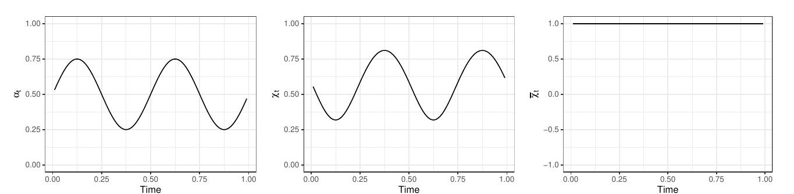
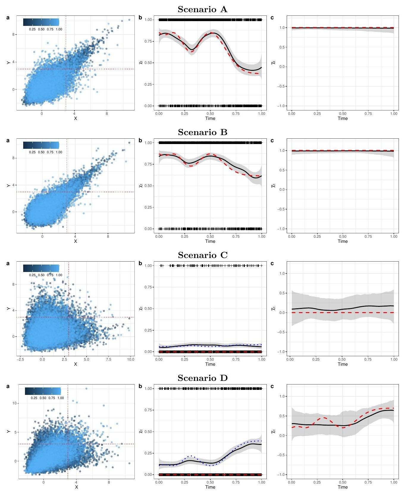
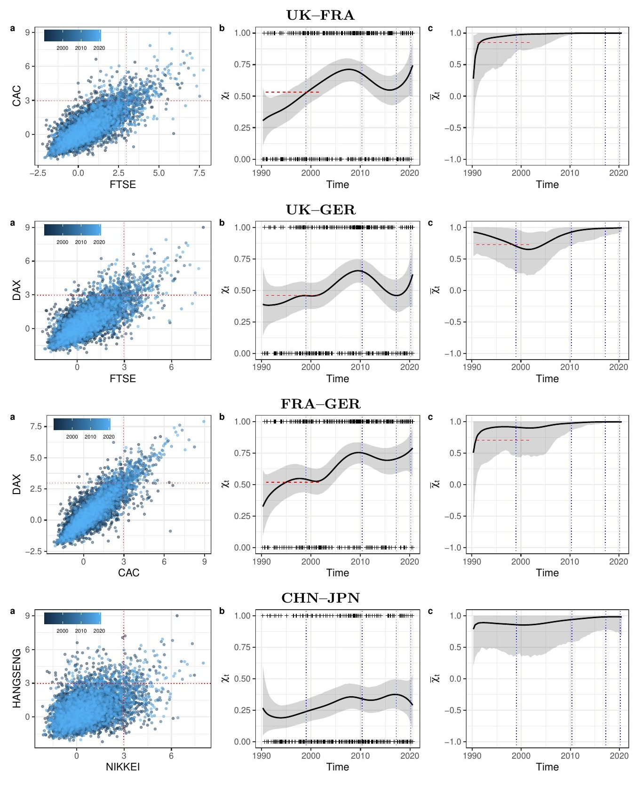
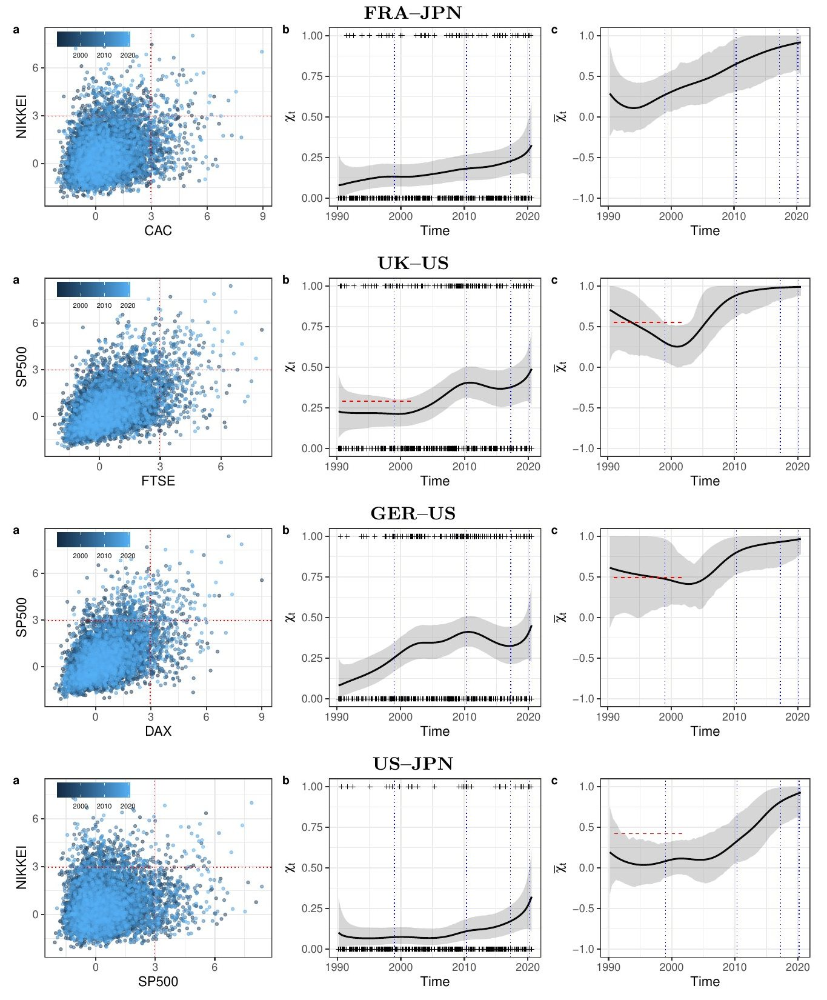

```{=html}
<div class="wt"><div class="wt-grid">
<div class="wt-main">

<div class="hero" id="summary">
  <div class="byline">이준호(금융감독원), Miguel de Carvalho(University of Edinburgh·Universidade de Aveiro), António Rua(Banco de Portugal·Nova SBE), Julio Avila(Pontificia Universidad Católica de Chile)</div>
  <p class="lead">평소에 함께 움직이는 시장이 폭락할 때도 함께 무너질까? 그 정도는 시간이 지나며 어떻게 변할까? 극단적 손실의 동조화를 재는 두 척도가 시간에 따라 매끄럽게 변하도록 베이즈 모형을 세우고, 1990년부터 2020년까지 6개 주요 증시에 적용하였다.</p>
  <div class="verdict"><b>한 줄 결론</b> — 극단적 손실의 동조화는 30년 동안 고정되어 있지 않았다. 유럽 시장 사이에서는 2010년까지 뚜렷하게 강해졌고, 미국–일본 같은 지역 간 쌍은 <b>독립에 가까운 상태에서 동반 폭락 쪽으로</b> 옮겨 갔다. 다만 표본 끝인 2020년 무렵의 추정은 불확실성이 크다.</div>
  <div class="stats">
    <div class="stat"><div class="n">30년</div><div class="l">일별 자료<br>(1990.3~2020.5)</div></div>
    <div class="stat"><div class="n">6개</div><div class="l">주요<br>주가지수</div></div>
    <div class="stat"><div class="n">15쌍</div><div class="l">지수 쌍<br>(그림은 8쌍)</div></div>
    <div class="stat"><div class="n">0.33→0.75</div><div class="l">프랑스–독일 χ<br>(1990→2010)</div></div>
    <div class="stat"><div class="n">0.09→0.93</div><div class="l">미국–일본 χ̄<br>(1999→2020)</div></div>
  </div>
  <details class="mtoc"><summary>목차</summary><ol>
    <li><a href="#why">왜 이 연구인가</a></li><li><a href="#measures">두 개의 척도</a></li>
    <li><a href="#model">분석 방법</a></li><li><a href="#sim">시뮬레이션</a></li>
    <li><a href="#data">데이터</a></li><li><a href="#res-within">결과 ① 같은 지역 안</a></li>
    <li><a href="#res-between">결과 ② 지역 사이</a></li><li><a href="#verdict">무엇이 확인되었나</a></li>
    <li><a href="#impl">시사점과 한계</a></li><li><a href="#glossary">용어 풀이</a></li></ol></details>
</div>

<section id="why">
<h2><span class="no">1</span>왜 이 연구인가</h2>
<p>분산 투자의 효과는 위기 때 가장 중요하다. 그런데 평소의 상관관계만으로는 폭락이 함께 오는지 알 수 없다. 예를 들어 이변량 정규분포에서는 상관계수가 양수여도, 기준을 극단으로 올릴수록 동시에 그 기준을 넘을 조건부 확률이 0으로 줄어든다.</p>
<div class="cards">
  <div class="card"><span class="tag">기존 한계 ①</span><div class="t">고정된 측정</div><p>Poon 등(2003, 2004)은 극단값 의존성을 쟀지만 기간별 분석은 표본을 임의로 나눈 탐색적 분석이었다.</p></div>
  <div class="card"><span class="tag">기존 한계 ②</span><div class="t">점근적 종속만 가정</div><p>시간 변화를 다룬 방법 대부분은 다변량 극단값 분포에 기반한다. 시장이 실제로는 점근적으로 독립이면 동반 극단 사건의 위험을 과대평가한다.</p></div>
  <div class="card"><span class="tag">이 논문</span><div class="t">두 상태를 함께, 시간에 따라</div><p>점근적 종속과 독립을 모두 다루는 시변 모형을 GLM처럼 간단히 적합한다. 두 상태를 모두 다룬 기존 방법으로는 Mhalla 등(2019b)이 있으며, 이 논문은 이와 성능을 비교한다.</p></div>
</div>
</section>

<section id="measures">
<h2><span class="no">2</span>두 개의 척도</h2>
<p>이 논문의 핵심은 극단적 동조화를 하나의 숫자로 요약하지 않는 것이다. χ<sub>t</sub>와 χ̄<sub>t</sub>를 함께 본다.</p>
<div class="cards">
  <div class="card"><span class="tag">0 ~ 1</span><div class="t">χ<sub>t</sub>: 얼마나 함께 무너지나</div><p>한 시장이 극단적 손실을 낸 때 다른 시장도 그럴 확률의 극한값이다. 0보다 크면 점근적으로 종속이다.</p></div>
  <div class="card"><span class="tag">−1 ~ 1</span><div class="t">χ̄<sub>t</sub>: 어떤 유형의 의존인가</div><p>1이면 점근적 종속의 신호이다. 1보다 작으면 χ = 0인 점근적 독립이며, 이때 값의 크기가 독립 범주 안에서의 의존 정도를 나타낸다.</p></div>
  <div class="card"><span class="tag">함께 읽기</span><div class="t">조합이 뜻하는 것</div><p>χ̄<sub>t</sub>가 1에 머물고 χ<sub>t</sub>가 오르면 극단적 의존이 강해진 것이다. χ<sub>t</sub>가 계속 0이고 χ̄<sub>t</sub>가 오르면 독립 범주 안에서 의존이 커진 것이다.</p></div>
</div>
<div class="box easy"><div class="h">숫자를 읽는 법</div><p>χ<sub>t</sub> = 0.7이라면, 대략 “한 시장이 임계값을 넘는 큰 손실을 낸 시기에 다른 시장도 그럴 확률이 70%”로 읽는다. 엄밀히는 임계값을 무한히 올린 극한의 값이고, 실제 추정은 높은 분위수 임계값에서 이루어진다.</p><p>논문은 Poon 등(2003)을 따라 <b>χ̄<sub>t</sub>가 1에 가깝다는 증거가 있을 때만 χ<sub>t</sub>에 초점을 두고, 그렇지 않으면 χ̄<sub>t</sub>에 초점을 두라</b>고 권한다.</p></div>
<details class="more"><summary>[그림 1] 시간에 따라 변하는 의존성의 예</summary><div>
<p>로지스틱 구조에서 의존 모수 α<sub>t</sub>가 0.25와 0.75 사이를 오가면 χ<sub>t</sub> = 2 − 2<sup>α<sub>t</sub></sup>도 함께 순환한다. χ̄<sub>t</sub>는 1로 고정된다. 즉, 유형은 그대로 점근적 종속이고 강도만 변한다.</p>
<figure class="pfig"><div class="imgbox"></div></figure>
</div></details>
</section>

<section id="model">
<h2><span class="no">3</span>분석 방법</h2>
<p>핵심 착안은 극단값 문제를 일반화선형모형(GLM)처럼 다루는 것이다. 극단 사건만 추려 내면 χ<sub>t</sub>에는 베르누이 자료, χ̄<sub>t</sub>에는 지수분포 자료가 근사적으로 생긴다.</p>
<ol class="timeline">
  <li><b>주변분포를 맞춘다.</b><span class="x">두 시계열을 단위 Fréchet 척도로 바꾼다. 주가 실증에서는 먼저 GARCH(1,1)로 변동성 변화를 걸러 낸다.</span></li>
  <li><b>극단 사건을 고른다.</b><span class="x">Y<sub>t</sub>가 임계값 u를 넘은 시점에 X<sub>t</sub>도 넘었는지를 I<sub>t</sub>(0 또는 1)로 기록한다. 두 값 중 작은 값 Z<sub>t</sub>가 u를 넘은 시점의 log(Z<sub>t</sub>/u)를 E<sub>t</sub>로 기록한다.</span></li>
  <li><b>관측 모형을 놓는다.</b><span class="x">I<sub>t</sub>는 평균이 χ<sub>t</sub>에 수렴하는 베르누이, E<sub>t</sub>는 평균이 η<sub>t</sub>에 수렴하는 지수분포를 근사적으로 따른다. χ̄<sub>t</sub> = 2η<sub>t</sub> − 1이다.</span></li>
  <li><b>시간 변화를 곡선으로 놓는다.</b><span class="x">연결함수와 B-스플라인으로 값의 범위를 지키면서 곡선을 만든다. 실증과 시뮬레이션 모두 매듭 20개, 3차 스플라인을 썼다.</span></li>
  <li><b>매끄러움은 자료에서 배운다.</b><span class="x">인접 계수 차이에 1차 확률보행 사전분포를 준다(Bayesian P-spline). τ²이 작을수록 곡선이 매끄럽고, τ²도 함께 추정한다. MCMC로 표본을 얻는다.</span></li>
</ol>
<div class="eq">χ<sub>t</sub> ≈ P(X<sub>t</sub> &gt; u | Y<sub>t</sub> &gt; u) = F{g(t)}<br>χ̄<sub>t</sub> ≈ 2H{l(t)} − 1</div>
<p>F와 H는 값을 허용 범위 안에 묶는 역연결함수, g와 l은 매끄러운 시간 함수이다. P-spline과 평활화의 기초는 블로그 글 <a href="../../posts/smoothing/smoothing1.html">평활화 기법 소개</a>와 <a href="../../posts/smoothing/smoothing2.html">베이지안 평활기법</a>에서 다룬다.</p>
</section>

<section id="sim">
<h2><span class="no">4</span>시뮬레이션: 방법이 작동하는가</h2>
<p>의존 모수가 알려진 곡선을 따르도록 네 시나리오의 자료를 만들었다. 표본은 40,000개, 임계값은 0.95 분위수, 반복은 500회이다. 정답 곡선과의 평균 적분 절대오차(MIAE)를 Mhalla 등(2019b) 방법과 비교하였다. 값이 작을수록 좋다.</p>
<figure class="tfig"><figcaption><span class="cap-no">[표 1]</span> 평균 적분 절대오차(MIAE), 시나리오별로 더 작은 값을 굵게 표시</figcaption><div class="tbl"><table>
<thead><tr><th class="l">시나리오</th><th class="l">유형</th><th>χ: 제안</th><th>χ: Mhalla</th><th>χ̄: 제안</th><th>χ̄: Mhalla</th></tr></thead>
<tbody>
<tr><td>A 로지스틱</td><td>점근적 종속</td><td><b>0.0280</b></td><td>0.0761</td><td><b>0.0108</b></td><td>0.4680</td></tr>
<tr><td>B 클레이턴</td><td>점근적 종속</td><td><b>0.0215</b></td><td>0.0590</td><td><b>0.0079</b></td><td>0.8866</td></tr>
<tr><td>C 모건스턴</td><td>점근적 독립</td><td><b>0.0088</b></td><td>0.0514</td><td>0.1016</td><td><b>0.0454</b></td></tr>
<tr><td>D 정규</td><td>점근적 독립</td><td><b>0.0194</b></td><td>0.1557</td><td>0.1125</td><td><b>0.1002</b></td></tr>
</tbody></table></div></figure>
<p>χ는 네 시나리오 모두, χ̄는 점근적 종속 두 시나리오에서 제안 방법의 오차가 작았다. <b>점근적 독립 시나리오의 χ̄는 Mhalla 등의 방법이 더 작았다</b>(C에서 약 절반). 논문의 표현이 “비슷하거나 더 낫다”(comparable, if not superior)인 이유이다.</p>
<div class="box warn"><div class="h">어려운 경우: 시나리오 D</div><p>참값 χ<sub>t</sub> = 0인 정규분포에서도 유한한 임계값에서는 χ<sub>t</sub>(u)가 0보다 훨씬 클 수 있다. 추정값은 극한값 0보다 이 임계값 수준의 χ<sub>t</sub>(u)에 더 가까웠다. 그래서 χ<sub>t</sub>만 보고 점근적 종속으로 판단하면 안 되고, χ̄<sub>t</sub>를 함께 봐야 한다.</p></div>
<details class="more"><summary>[그림 2] 시나리오별 1회 실험 결과</summary><div>
<figure class="pfig"><div class="imgbox"></div><p class="note">주: 왼쪽은 로그 변환 자료의 산점도, 가운데와 오른쪽은 χ<sub>t</sub>와 χ̄<sub>t</sub>이다. 실선은 사후평균, 회색은 신용구간, 파선은 참값, 점선은 임계값 수준의 χ<sub>t</sub>(u)이다.</p></figure>
</div></details>
</section>

<section id="data">
<h2><span class="no">5</span>데이터</h2>
<p>Datastream의 일별 종가로 1990년 3월 5일부터 2020년 5월 4일까지의 음의 로그수익률(손실)을 만들었다. 대상은 CAC 40(프랑스), DAX 30(독일), FTSE 100(영국), Hang Seng(논문 표기 CHN), Nikkei 225(일본), S&amp;P 500(미국)이다. GARCH(1,1) 필터를 거친 뒤 모든 쌍을 분석하였다.</p>
<p>먼저 기간 전체를 하나의 값으로 요약하면 같은 지역 안의 의존성이 높다. 평균 χ는 유럽 내 3쌍이 약 0.50, 유럽–미국 3쌍이 약 0.22, 유럽–동아시아 6쌍이 약 0.13이다(평균은 이 해설의 계산).</p>
<figure class="tfig"><figcaption><span class="cap-no">[표 2]</span> 기간 전체의 χ와 χ̄(GARCH 필터 후)</figcaption><div class="tbl"><table>
<thead><tr><th class="l">묶음</th><th class="l">쌍</th><th>χ</th><th>χ̄</th></tr></thead>
<tbody>
<tr><td>같은 지역</td><td>프랑스–독일</td><td>0.54</td><td>0.88</td></tr>
<tr><td>같은 지역</td><td>영국–프랑스</td><td>0.50</td><td>0.75</td></tr>
<tr><td>같은 지역</td><td>영국–독일</td><td>0.47</td><td>0.85</td></tr>
<tr><td>같은 지역</td><td>항셍–일본</td><td>0.23</td><td>0.59</td></tr>
<tr><td>미국과</td><td>독일–미국</td><td>0.24</td><td>0.72</td></tr>
<tr><td>미국과</td><td>영국–미국</td><td>0.22</td><td>0.63</td></tr>
<tr><td>미국과</td><td>프랑스–미국</td><td>0.21</td><td>0.62</td></tr>
<tr><td>미국과</td><td>일본–미국</td><td>0.10</td><td>0.43</td></tr>
<tr><td>미국과</td><td>항셍–미국</td><td>0.08</td><td>0.30</td></tr>
<tr><td>유럽–동아시아</td><td>영국–항셍</td><td>0.16</td><td>0.51</td></tr>
<tr><td>유럽–동아시아</td><td>독일–항셍</td><td>0.15</td><td>0.43</td></tr>
<tr><td>유럽–동아시아</td><td>독일–일본</td><td>0.14</td><td>0.52</td></tr>
<tr><td>유럽–동아시아</td><td>영국–일본</td><td>0.13</td><td>0.45</td></tr>
<tr><td>유럽–동아시아</td><td>프랑스–일본</td><td>0.12</td><td>0.46</td></tr>
<tr><td>유럽–동아시아</td><td>프랑스–항셍</td><td>0.09</td><td>0.40</td></tr>
</tbody></table></div></figure>
<p>시간 변화를 읽을 때는 논문이 표시한 네 사건을 기준으로 삼는다.</p>
<ol class="timeline">
  <li><span class="d">1999.1.1</span><b>t<sub>A</sub></b> 유럽 경제통화동맹 3단계 시작</li>
  <li><span class="d">2010.5.2</span><b>t<sub>B</sub></b> 그리스 지원 패키지 가동, 유럽 재정위기 촉발</li>
  <li><span class="d">2017.3.29</span><b>t<sub>C</sub></b> 영국의 리스본 조약 50조 발동(브렉시트)</li>
  <li><span class="d">2020.3.11</span><b>t<sub>D</sub></b> WHO의 코로나19 팬데믹 선언</li>
</ol>
</section>

<section id="res-within">
<h2><span class="no">6</span>결과 ① 같은 지역 안</h2>
<figure class="pfig"><figcaption><span class="cap-no">[그림 3]</span> 같은 지역 안의 쌍: 영국–프랑스, 영국–독일, 프랑스–독일, 항셍–일본</figcaption><div class="imgbox"></div><p class="note">주: 왼쪽은 로그 변환 자료의 산점도이다. 가운데(χ<sub>t</sub>)와 오른쪽(χ̄<sub>t</sub>)의 실선은 사후평균, 회색은 신용구간, 빨간 파선은 Poon 등(2003)의 기간 값, 파란 세로 점선은 네 사건이다.</p></figure>
<ul>
  <li><b>2010년까지 상승:</b> χ<sub>t</sub>가 2010년에 1990년보다 높을 사후확률은 영국–프랑스 0.92, 프랑스–독일 0.98이다.</li>
  <li><b>재정위기 후 정체:</b> 유럽 쌍의 상승세는 브렉시트 발동 무렵까지 멈췄다. 2010년 값이 2017년 값보다 클 사후확률은 영국–프랑스 0.85, 프랑스–독일 0.80, 영국–독일 0.70이다.</li>
  <li><b>2017년 후 소폭 상승:</b> 유럽 쌍 모두 다시 올랐으나 영국–독일은 증거가 약하다고 논문은 평가한다.</li>
  <li><b>동아시아는 변화가 작음:</b> 항셍–일본은 유럽 쌍보다 수준이 낮고 변화도 훨씬 작았다.</li>
  <li><b>유형은 점근적 종속 쪽:</b> 같은 지역 안의 χ̄<sub>t</sub>는 대체로 1에 가까워, χ<sub>t</sub>를 강도의 지표로 읽을 근거가 된다. 영국–독일은 2001년 무렵 약 0.65까지 내려갔고 구간도 넓다.</li>
</ul>
</section>

<section id="res-between">
<h2><span class="no">7</span>결과 ② 지역 사이와 미국과의 관계</h2>
<figure class="pfig"><figcaption><span class="cap-no">[그림 4]</span> 지역 사이의 쌍: 프랑스–일본, 영국–미국, 독일–미국, 미국–일본</figcaption><div class="imgbox"></div><p class="note">주: 표기는 그림 3과 같다. 나머지 쌍의 그림은 논문의 부록에 있다.</p></figure>
<p>여기서는 χ̄<sub>t</sub>의 변화가 더 뚜렷하다. 네 쌍 모두 1999년 이후 대체로 상승하여 최근에는 1에 가까워졌다. 논문은 이를 최근 모든 쌍에서 점근적 종속을 시사하는 결과로 해석한다.</p>
<figure class="pfig"><figcaption><span class="cap-no">[해설 그림 1]</span> χ̄<sub>t</sub> 사후평균의 변화: 1999년 1월과 2020년 3월</figcaption><div class="svgbox"><svg xmlns="http://www.w3.org/2000/svg" viewBox="0 0 620 390" role="img" aria-label="쌍별 χ̄ 추정값의 1999년 1월과 2020년 3월 비교. 미국–일본이 0.09에서 0.93으로 가장 크게 오르고, 유럽 쌍은 처음부터 1에 가깝다." font-family="Roboto, 'Noto Sans KR', sans-serif"><rect width="620" height="390" fill="#fff"/><circle cx="122" cy="16" r="6" fill="#fff" stroke="#325d88" stroke-width="2"/><text x="134" y="21" font-size="14" fill="#3e3f3a">1999년 1월</text><circle cx="232" cy="16" r="6" fill="#325d88"/><text x="244" y="21" font-size="14" fill="#3e3f3a">2020년 3월</text><line x1="116.0" x2="116.0" y1="40" y2="360" stroke="#dfd7ca" stroke-width="1"/><text x="116.0" y="380" text-anchor="middle" font-size="14" fill="#6f6e67">0.00</text><line x1="213.0" x2="213.0" y1="40" y2="360" stroke="#dfd7ca" stroke-width="1"/><text x="213.0" y="380" text-anchor="middle" font-size="14" fill="#6f6e67">0.25</text><line x1="310.0" x2="310.0" y1="40" y2="360" stroke="#dfd7ca" stroke-width="1"/><text x="310.0" y="380" text-anchor="middle" font-size="14" fill="#6f6e67">0.50</text><line x1="407.0" x2="407.0" y1="40" y2="360" stroke="#dfd7ca" stroke-width="1"/><text x="407.0" y="380" text-anchor="middle" font-size="14" fill="#6f6e67">0.75</text><line x1="504.0" x2="504.0" y1="40" y2="360" stroke="#6f6e67" stroke-width="1.5"/><text x="504.0" y="380" text-anchor="middle" font-size="14" fill="#6f6e67">1.00</text><g><title>미국–일본: 1999년 1월 0.09 (구간 −0.12 ~ 0.32), 2020년 3월 0.93 (구간 0.59 ~ 1.00)</title><rect x="0" y="40.0" width="620" height="40" fill="transparent"/><text x="104" y="65.0" text-anchor="end" font-size="15" fill="#3e3f3a">미국–일본</text><line x1="149.0" x2="474.9" y1="60.0" y2="60.0" stroke="#325d88" stroke-width="2"/><circle cx="149.0" cy="60.0" r="6" fill="#fff" stroke="#325d88" stroke-width="2"/><circle cx="474.9" cy="60.0" r="6" fill="#325d88" stroke="#fff" stroke-width="2"/><text x="518" y="65.0" font-size="14" fill="#3e3f3a">0.09 → <tspan font-weight="700">0.93</tspan></text></g><g><title>프랑스–일본: 1999년 1월 0.28 (구간 0.05 ~ 0.54), 2020년 3월 0.92 (구간 0.53 ~ 1.00)</title><rect x="0" y="80.0" width="620" height="40" fill="transparent"/><text x="104" y="105.0" text-anchor="end" font-size="15" fill="#3e3f3a">프랑스–일본</text><line x1="223.1" x2="471.0" y1="100.0" y2="100.0" stroke="#325d88" stroke-width="2"/><circle cx="223.1" cy="100.0" r="6" fill="#fff" stroke="#325d88" stroke-width="2"/><circle cx="471.0" cy="100.0" r="6" fill="#325d88" stroke="#fff" stroke-width="2"/><text x="518" y="105.0" font-size="14" fill="#3e3f3a">0.28 → <tspan font-weight="700">0.92</tspan></text></g><g><title>영국–미국: 1999년 1월 0.30 (구간 0.06 ~ 0.55), 2020년 3월 0.99 (구간 0.88 ~ 1.00)</title><rect x="0" y="120.0" width="620" height="40" fill="transparent"/><text x="104" y="145.0" text-anchor="end" font-size="15" fill="#3e3f3a">영국–미국</text><line x1="232.0" x2="499.7" y1="140.0" y2="140.0" stroke="#325d88" stroke-width="2"/><circle cx="232.0" cy="140.0" r="6" fill="#fff" stroke="#325d88" stroke-width="2"/><circle cx="499.7" cy="140.0" r="6" fill="#325d88" stroke="#fff" stroke-width="2"/><text x="518" y="145.0" font-size="14" fill="#3e3f3a">0.30 → <tspan font-weight="700">0.99</tspan></text></g><g><title>독일–미국: 1999년 1월 0.47 (구간 0.14 ~ 0.96), 2020년 3월 0.97 (구간 0.77 ~ 1.00)</title><rect x="0" y="160.0" width="620" height="40" fill="transparent"/><text x="104" y="185.0" text-anchor="end" font-size="15" fill="#3e3f3a">독일–미국</text><line x1="299.9" x2="490.8" y1="180.0" y2="180.0" stroke="#325d88" stroke-width="2"/><circle cx="299.9" cy="180.0" r="6" fill="#fff" stroke="#325d88" stroke-width="2"/><circle cx="490.8" cy="180.0" r="6" fill="#325d88" stroke="#fff" stroke-width="2"/><text x="518" y="185.0" font-size="14" fill="#3e3f3a">0.47 → <tspan font-weight="700">0.97</tspan></text></g><g><title>영국–독일: 1999년 1월 0.70 (구간 0.27 ~ 0.97), 2020년 3월 0.99 (구간 0.92 ~ 1.00)</title><rect x="0" y="200.0" width="620" height="40" fill="transparent"/><text x="104" y="225.0" text-anchor="end" font-size="15" fill="#3e3f3a">영국–독일</text><line x1="386.0" x2="500.9" y1="220.0" y2="220.0" stroke="#325d88" stroke-width="2"/><circle cx="386.0" cy="220.0" r="6" fill="#fff" stroke="#325d88" stroke-width="2"/><circle cx="500.9" cy="220.0" r="6" fill="#325d88" stroke="#fff" stroke-width="2"/><text x="518" y="225.0" font-size="14" fill="#3e3f3a">0.70 → <tspan font-weight="700">0.99</tspan></text></g><g><title>항셍–일본: 1999년 1월 0.86 (구간 0.38 ~ 1.00), 2020년 3월 0.98 (구간 0.69 ~ 1.00)</title><rect x="0" y="240.0" width="620" height="40" fill="transparent"/><text x="104" y="265.0" text-anchor="end" font-size="15" fill="#3e3f3a">항셍–일본</text><line x1="448.1" x2="496.6" y1="260.0" y2="260.0" stroke="#325d88" stroke-width="2"/><circle cx="448.1" cy="260.0" r="6" fill="#fff" stroke="#325d88" stroke-width="2"/><circle cx="496.6" cy="260.0" r="6" fill="#325d88" stroke="#fff" stroke-width="2"/><text x="518" y="265.0" font-size="14" fill="#3e3f3a">0.86 → <tspan font-weight="700">0.98</tspan></text></g><g><title>프랑스–독일: 1999년 1월 0.91 (구간 0.44 ~ 1.00), 2020년 3월 0.99 (구간 0.98 ~ 1.00)</title><rect x="0" y="280.0" width="620" height="40" fill="transparent"/><text x="104" y="305.0" text-anchor="end" font-size="15" fill="#3e3f3a">프랑스–독일</text><line x1="468.7" x2="501.7" y1="300.0" y2="300.0" stroke="#325d88" stroke-width="2"/><circle cx="468.7" cy="300.0" r="6" fill="#fff" stroke="#325d88" stroke-width="2"/><circle cx="501.7" cy="300.0" r="6" fill="#325d88" stroke="#fff" stroke-width="2"/><text x="518" y="305.0" font-size="14" fill="#3e3f3a">0.91 → <tspan font-weight="700">0.99</tspan></text></g><g><title>영국–프랑스: 1999년 1월 0.97 (구간 0.71 ~ 1.00), 2020년 3월 1.00 (구간 1.00 ~ 1.00)</title><rect x="0" y="320.0" width="620" height="40" fill="transparent"/><text x="104" y="345.0" text-anchor="end" font-size="15" fill="#3e3f3a">영국–프랑스</text><line x1="493.5" x2="504.0" y1="340.0" y2="340.0" stroke="#325d88" stroke-width="2"/><circle cx="493.5" cy="340.0" r="6" fill="#fff" stroke="#325d88" stroke-width="2"/><circle cx="504.0" cy="340.0" r="6" fill="#325d88" stroke="#fff" stroke-width="2"/><text x="518" y="345.0" font-size="14" fill="#3e3f3a">0.97 → <tspan font-weight="700">1.00</tspan></text></g></svg></div><p class="note">주: 논문 그림 3·4의 벡터 좌표에서 읽어 이 해설이 다시 그렸다. 신용구간은 아래 표에 함께 적었으며, 논문 본문에는 구간의 수준이 적혀 있지 않다.</p></figure>
<figure class="tfig"><figcaption><span class="cap-no">[표 3]</span> 주요 시점의 추정값과 신용구간</figcaption><div class="tbl"><table>
<thead><tr><th class="l">쌍</th><th>χ 1990</th><th>χ 2010</th><th>χ 2017</th><th>χ 2020</th><th>χ̄ 1999</th><th>χ̄ 2020</th></tr></thead>
<tbody>
<tr><td>영국–프랑스</td><td>0.31</td><td>0.67</td><td>0.56</td><td>0.73<br><span class="note">[0.50, 0.91]</span></td><td>0.97<br><span class="note">[0.71, 1.00]</span></td><td>1.00<br><span class="note">[1.00, 1.00]</span></td></tr>
<tr><td>영국–독일</td><td>0.39</td><td>0.65</td><td>0.46</td><td>0.61<br><span class="note">[0.37, 0.83]</span></td><td>0.70<br><span class="note">[0.27, 0.97]</span></td><td>0.99<br><span class="note">[0.92, 1.00]</span></td></tr>
<tr><td>프랑스–독일</td><td>0.33</td><td>0.75</td><td>0.71</td><td>0.78<br><span class="note">[0.57, 0.93]</span></td><td>0.91<br><span class="note">[0.44, 1.00]</span></td><td>0.99<br><span class="note">[0.98, 1.00]</span></td></tr>
<tr><td>항셍–일본</td><td>0.27</td><td>0.34</td><td>0.37</td><td>0.30<br><span class="note">[0.12, 0.52]</span></td><td>0.86<br><span class="note">[0.38, 1.00]</span></td><td>0.98<br><span class="note">[0.69, 1.00]</span></td></tr>
<tr><td>프랑스–일본</td><td>0.08</td><td>0.18</td><td>0.23</td><td>0.32<br><span class="note">[0.12, 0.56]</span></td><td>0.28<br><span class="note">[0.05, 0.54]</span></td><td>0.92<br><span class="note">[0.53, 1.00]</span></td></tr>
<tr><td>영국–미국</td><td>0.23</td><td>0.41</td><td>0.38</td><td>0.48<br><span class="note">[0.28, 0.69]</span></td><td>0.30<br><span class="note">[0.06, 0.55]</span></td><td>0.99<br><span class="note">[0.88, 1.00]</span></td></tr>
<tr><td>독일–미국</td><td>0.08</td><td>0.41</td><td>0.33</td><td>0.44<br><span class="note">[0.23, 0.66]</span></td><td>0.47<br><span class="note">[0.14, 0.96]</span></td><td>0.97<br><span class="note">[0.77, 1.00]</span></td></tr>
<tr><td>미국–일본</td><td>0.10</td><td>0.11</td><td>0.18</td><td>0.31<br><span class="note">[0.11, 0.56]</span></td><td>0.09<br><span class="note">[−0.12, 0.32]</span></td><td>0.93<br><span class="note">[0.59, 1.00]</span></td></tr>
</tbody></table></div><p class="note">주: 논문이 표로 제시한 값이 아니라 그림의 곡선 좌표에서 읽은 근사값이다. 시점은 1990년 3월, 2010년 5월, 2017년 3월, 2020년 3월, 1999년 1월이며 대괄호는 같은 시점의 신용구간이다.</p></figure>
<div class="box easy"><div class="h">왜 프랑스와 일본이 함께 움직이나</div><p>논문은 금융 맥락의 예로 프랑스–일본을 든다. 2006년 시라크 당시 대통령은 CAC 40 대기업 자본의 45%를 외국 회사가 보유한다고 말했고, 프랑스은행 자료에 따르면 일본은 2010~2015년 CAC 40의 주요 비거주 보유국이었다. 다만 이는 배경 설명이며, 소유 구조가 동조화의 원인임을 검증한 분석은 아니다.</p></div>
</section>

<section id="verdict">
<h2><span class="no">8</span>무엇이 확인되었나</h2>
<figure class="tfig"><div class="tbl"><table class="score">
<thead><tr><th class="l">주장</th><th class="l">근거</th><th class="l">읽는 법</th></tr></thead>
<tbody>
<tr><td>제안 방법이 시변 의존성을 복원한다</td><td>500회 시뮬레이션, 표 1</td><td>χ는 강함. 점근적 독립의 χ̄는 비교 방법이 더 나은 경우 있음</td></tr>
<tr><td>유럽의 극단적 동조화가 2010년까지 강해졌다</td><td>사후확률 0.92(영국–프랑스), 0.98(프랑스–독일)</td><td>증거가 강함. 영국–독일은 이 수치가 보고되지 않음</td></tr>
<tr><td>재정위기 후 정체, 브렉시트 무렵 후 재상승</td><td>사후확률 0.70~0.85, 그림 3</td><td>정체는 중간 정도의 증거. 재상승은 사후확률 미보고, 구간 넓음</td></tr>
<tr><td>지역 간 쌍도 최근 점근적 종속 쪽으로 이동했다</td><td>그림 4의 χ̄<sub>t</sub></td><td>방향은 뚜렷함. 점근적 종속 여부를 형식적으로 검정한 것은 아님</td></tr>
</tbody></table></div></figure>
</section>

<section id="impl">
<h2><span class="no">9</span>시사점과 한계</h2>
<h3>시사점</h3>
<ul>
  <li><b>위험 분산:</b> 시장이 폭락 때 함께 움직이는 정도가 변하므로, 고정된 값이나 평소의 상관만으로 분산 효과를 판단하면 위험을 잘못 볼 수 있다.</li>
  <li><b>방법:</b> GLM처럼 간단히 적합할 수 있고, 점근적 독립일 때 동반 극단 위험을 과대평가하는 문제를 피하도록 설계되었다.</li>
  <li><b>응용:</b> 극단 사건이 시간에 따라 변하는 기후, 지질, 수문 자료에도 적용할 수 있다.</li>
</ul>
<h3>논문이 밝힌 한계와 다음 과제</h3>
<ul>
  <li><b>쌍별 분석:</b> 쌍의 결과만으로 셋 이상의 시장이 함께 폭락할 확률은 알 수 없다.</li>
  <li><b>유한 임계값:</b> 모든 극단값 방법처럼 극한에 도달하지 않은 자료를 쓰는 대가가 있다.</li>
  <li><b>다음 과제:</b> 구조 변화와 급변 추적, 공변량을 넣은 일반화가법모형, Bayesian Lasso를 제안한다.</li>
</ul>
<div class="box warn"><div class="h">이 해설에서 덧붙이는 주의점</div><ul>
  <li><b>표본 끝의 불확실성:</b> 곡선의 양 끝은 자료가 한쪽에만 있어 구간이 넓다. 예컨대 표본 끝인 2020년 5월의 영국–프랑스 χ<sub>t</sub> 구간은 약 0.49~0.93이다. 코로나19 직후의 상승은 잠정적으로 읽어야 하고, 자료는 2020년 5월에서 끝난다.</li>
  <li><b>사건과 원인:</b> 세로선은 해석을 돕는 표시이며, 사건의 효과를 식별한 것은 아니다. 2017년 이후의 상승에는 브렉시트와 코로나19가 겹쳐 있다.</li>
  <li><b>χ̄ = 1의 판단:</b> χ̄<sub>t</sub>는 1을 넘을 수 없으므로 구간이 1에 닿는 것만으로 점근적 종속이 입증되지는 않는다.</li>
  <li><b>구간 비교:</b> 시점별 구간의 겹침은 두 시점 차이의 검정이 아니다. 미국–일본과 영국–미국의 χ̄는 1999년과 2020년 구간이 겹치지 않지만, 독일–미국은 겹친다.</li>
  <li><b>거래 시간차:</b> 일별 종가를 쓰므로 마감 시각이 다른 지역 사이에서는 같은 충격이 다른 날짜에 반영될 수 있다. 본문에서는 이 조정을 다루지 않아, 지역 간 값이 낮게 나올 가능성이 있다.</li>
  <li><b>항셍의 표기:</b> 논문은 Hang Seng을 CHN(중국)으로 표기하지만, 이 지수는 홍콩 시장의 지수이다. 중국 본토 시장으로 바로 일반화하면 안 된다.</li>
  <li><b>부록:</b> 이 해설은 본문만 확인하였다. 민감도 분석, 시간에 따라 변하는 주변분포 실험, 나머지 쌍의 그림은 부록에 있다.</li>
</ul></div>
</section>

<section id="glossary">
<h2>용어 풀이</h2>
<dl class="gloss">
  <dt>점근적 종속</dt><dd>기준을 아무리 극단으로 올려도 함께 넘을 조건부 확률이 0이 되지 않는 상태(χ &gt; 0).</dd>
  <dt>점근적 독립</dt><dd>기준을 극단으로 올릴수록 함께 넘을 조건부 확률이 0으로 줄어드는 상태(χ = 0). 그 전까지는 양의 의존이 있을 수 있다.</dd>
  <dt>꼬리의존계수 η</dt><dd>동시 초과 확률이 기준에 따라 줄어드는 속도를 나타낸다. χ̄ = 2η − 1이다.</dd>
  <dt>사후확률·신용구간</dt><dd>자료를 본 뒤 모수에 대해 갖는 확률과, 모수가 일정 확률로 들어 있는 구간이다.</dd>
  <dt>P-spline</dt><dd>구간별 다항식을 이어 만든 곡선에서 인접 계수의 차이에 벌점을 주어 매끄럽게 만드는 방법이다.</dd>
  <dt>GARCH(1,1)</dt><dd>수익률 변동성이 시기에 따라 변하는 것을 모형화한다. 이를 걸러 내면 변동성 변화와 의존성 변화를 구분하는 데 도움이 된다.</dd>
  <dt>단위 Fréchet 척도</dt><dd>두 변수의 단위를 같게 맞춘 척도이다. P(X &gt; u) = exp(−1/u)로 두어 의존 구조만 비교할 수 있게 한다.</dd>
  <dt>MIAE</dt><dd>추정 곡선과 참 곡선의 차이를 전 구간에서 적분해 평균낸 오차이다. 작을수록 좋다.</dd>
</dl>
</section>

<div class="wt-foot">
<p>논문: Lee, J., de Carvalho, M., Rua, A. &amp; Avila, J. (2024). Bayesian smoothing for time-varying extremal dependence. <i>Journal of the Royal Statistical Society: Series C</i>, 73(3), 581–597. <a href="https://doi.org/10.1093/jrsssc/qlae002">doi:10.1093/jrsssc/qlae002</a>.</p>
<p>그림 1~4는 논문 원고의 그림을 잘라 옮겼고(<a href="https://creativecommons.org/licenses/by/4.0/">CC BY 4.0</a>), 설명과 표는 이 페이지를 위해 번역·발췌하였다. 해설 그림 1과 표 3은 논문 그림의 곡선 좌표에서 새로 만들었다. 이 페이지는 연구 내용의 해설이며, 소속 기관의 공식 견해가 아니다.</p>
</div>

</div>
<nav class="wt-toc" aria-label="목차">
  <div class="t">목차</div>
  <a href="#summary">요약</a>
  <a href="#why">1. 왜 이 연구인가</a>
  <a href="#measures">2. 두 개의 척도</a>
  <a href="#model">3. 분석 방법</a>
  <a href="#sim">4. 시뮬레이션</a>
  <a href="#data">5. 데이터</a>
  <a href="#res-within">6. 결과 ① 같은 지역 안</a>
  <a href="#res-between">7. 결과 ② 지역 사이</a>
  <a href="#verdict">8. 무엇이 확인되었나</a>
  <a href="#impl">9. 시사점과 한계</a>
  <a href="#glossary">용어 풀이</a>
</nav>
</div></div>
<script>
(function(){
  var links=[].slice.call(document.querySelectorAll('.wt-toc a')), secs=links.map(function(a){return document.querySelector(a.getAttribute('href'))});
  if('IntersectionObserver' in window){
    var io=new IntersectionObserver(function(es){es.forEach(function(e){if(e.isIntersecting){var i=secs.indexOf(e.target);links.forEach(function(l,j){l.classList.toggle('on',i===j)})}})},{rootMargin:'-20% 0px -70% 0px'});
    secs.forEach(function(s){s&&io.observe(s)});
  }
})();
</script>
```
